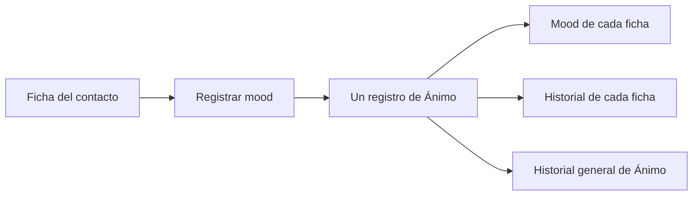

# CHG-185 · Editor común de tareas y Mood en contactos
**Estado:** En verificación
**Nivel:** M
**Modelo sugerido:** estandar
<!-- Estados y nivel se cambian SOLO con node .claude/team.mjs. Modelo: un perfil de docs/TEAM_MODELS.md -->
**Creado:** 2026-11-19 · **Aprobado:** 2026-11-19 · **Cerrado:** —
**Relacionado:** —

## 0. En palabras simples

- Desde una ficha o Cumpleaños, crea una tarea con el editor habitual y el contacto preseleccionado.
- Registra cómo te sentiste ayer, añade a las personas involucradas y comprueba que la misma entrada aparece en Ánimo y en Mood e Historial de cada ficha.

## 1. Resumen

Consolidar los formularios de tareas de Relaciones en TaskEditor. Extender Ánimo a las fichas de contacto mediante los vínculos existentes. Edwin confirmó el alcance y el flujo del boceto.

## 2. Producto (product-manager)

- Incluye Inicio de la ficha, Tareas relacionadas y Cumpleaños, más consulta y gestión de Mood e integración con Historial.
- Los pendientes propios de Salud conservan su flujo.
- Un registro con varios contactos aparece en todas sus fichas. Editarlo actualiza todas sus apariciones. Retirar un vínculo afecta solo su ficha. Eliminar el registro lo retira de todas las vistas.

## 3. UX/UI

### 3.1 Experiencia (ux-designer)

Plantilla: detalle con pestañas y tarjeta de gestión, según la navegación de detalle del sistema de diseño. Mood es visible con contador en cero. Desde FAB, elipsis o estado vacío se abre el mismo formulario. Al crear se conserva el contacto de origen; al editar se puede quitar cualquier vínculo.

```text
←  Inicio | Planes | Historial | Tareas relacionadas | Mood (2)
Mood (2)                                            ⋮
[Buscar registros] [Emoción] [Fechas]
Fecha       Emoción     Detalle        Contactos     ⋮
18 nov      😔 Triste   Lo que pasó    Alison, Ana   ⋮
                                    [+ Registrar mood]

Registrar mood
[Emoción] [Fecha]
[Detalle]
[Alison · contacto de origen] [Agregar contactos ▾]
                                    [Cancelar] [Guardar]
```



### 3.2 Visual (ui-designer)

Reutilizar shell, tarjeta de gestión, tabla apilable, FAB, diálogo y selector múltiple. Usar las representaciones de emoción existentes y probar teclado, foco y móvil.

### 3.3 Escritura (ux-writer)

Usar «Mood», «Registrar mood», «Ver detalle», «Editar» y «Eliminar». En la confirmación de borrado indicar que el registro se elimina de Ánimo y de todas las fichas vinculadas.

## 4. Diseño técnico (software-architect)

- TaskEditor resuelve el contacto propio en el servidor. Precarga Personas y garantiza su vínculo al guardar en la transacción existente. Conservar la sugerencia Social si existe y el título y fecha de fin sugeridos para Cumpleaños. Limpiar el contexto entre aperturas y refrescar las listas con task-editor-saved.
- Compartir el formulario completo con Ánimo sin cambiar el registro rápido ni la reflexión. Reutilizar catálogo, MoodLogger, applyMoodState y mood_entry_relationship. Fecha editable, detalle de hasta 500 caracteres y selector con búsqueda. Validar propiedad de registros y relaciones. Guardar registro y vínculos en una transacción. Conservar intensidad, reflexión y origen.
- Añadir relationships.mood y PersonTabs con total sin filtrar. Paginar por fecha y timestamp descendentes, buscar por emoción y detalle y filtrar por emoción y fechas. Refrescar filas y contador tras cambios. Incluir relaciones archivadas ya vinculadas.
- RelationshipHistoryEntries incorpora Mood en el historial completo y reciente y añade filtro por tipo. Ordenar por fecha emocional. Abrir el mismo diálogo de consulta.
- Sin migraciones. Los vínculos actuales son la fuente de verdad.

## 5. Pruebas (qa-tester)

| Caso | Tipo | Nivel | Test |
|---|---|---|---|
| Editor contextual y regresión de Tareas, Planes y Objetivos | Funcional | Feature | TaskEditorRelationsTest, RelationshipBirthdaysTest y flujos de ficha |
| Crear ayer, editar, retirar uno o todos los vínculos y borrar | Funcional | Feature | Relaciones y Ánimo |
| Aislamiento, registros anteriores, archivados, filtros y cero | Funcional | Feature | Relaciones y Ánimo |
| FAB, elipsis, selector, foco y filas apiladas | Interacción | Navegador | Escritorio y móvil |

Ejecutar pruebas PHP afectadas, npm run build, php artisan ui:conformance y git diff --check.

## 6. Documentación (tech-writer)

El CHG documenta el alcance y los criterios. Registrar la evidencia de implementación y verificación en su bitácora. El CLI local carece de context; consultar las guías directamente.

## 7. Tareas

- [x] T1 · Crear tareas con el editor habitual desde la ficha y Cumpleaños — Resp: developer — Archivos: app/Livewire/Task/TaskEditor.php, app/Livewire/Relationship, resources/views/livewire/relationship — Hecho cuando: el contacto queda vinculado y se retiran los formularios independientes.
- [x] T2 · Registrar y editar un Mood con varios contactos — Resp: developer — Archivos: app/Livewire/Mood, resources/views/livewire/mood, app/Support/MoodLogger.php — Hecho cuando: se comparte el editor completo y se guarda una sola entrada con sus vínculos.
- [x] T3 · Consultar Mood en la ficha y en Historial — Resp: developer — Archivos: routes/web.php, app/Support/Ui/Tabs/PersonTabs.php, app/Support/Relationships/RelationshipHistoryEntries.php, app/Livewire/Relationship, resources/views/livewire/relationship — Hecho cuando: aparecen las entradas vinculadas con filtros, contador y consulta responsive.
- [ ] T4 · Verificar los recorridos y regresiones — Resp: qa-tester — Archivos: tests/Feature — Hecho cuando: pasan las comprobaciones de la sección 5.

## 8. Bitácora de implementación (developer)

- T1 · La ficha y Cumpleaños abren TaskEditor y se retiraron sus formularios independientes. Chromium comprobó la precarga de contacto y del título de Cumpleaños.
- T2 · El editor de Mood comparte los registros de Ánimo y usa los vínculos existentes. Las pruebas comprobaron tres contactos, fecha anterior, edición, aislamiento, desvinculación y borrado.
- T3 · Mood e Historial muestran la misma entrada. Chromium comprobó el selector con búsqueda, la fila móvil y el detalle desde otra ficha.
- Validación de desarrollo · PHP: 85 de 87 pasan. Las dos fallas de RelationshipDetailTest y RelationshipTimelineTest se reproducen en HEAD. Vite y git diff --check pasan. UI conformance reporta 189 desviaciones inventariadas frente a 191 en HEAD, sin nuevas desviaciones. context y activity no están disponibles en el CLI local.

- Ajuste tras revisión · «Módulo» usa el selector con búsqueda del sistema. Chromium verificó la precarga, el filtrado por texto, la selección con teclado y el reinicio de «Relación» al cambiar de módulo. TaskEditorRelationsTest: 4 de 4 pasan.

## 9. Preguntas abiertas, decisiones e historial
- 2026-11-19 — Creado en to-do/ (Borrador, nivel M)
- Alcance confirmado: ficha y Cumpleaños. El contacto de origen se mantiene al crear Mood.
- 2026-11-19 — Aprobado por el usuario (Compuerta 2)
- 2026-11-19 — Movido a in-progress/ (En desarrollo)
- LECCIÓN: ninguna.
- 2026-11-19 — Implementación terminada → En verificación
- 2026-11-19 — Reabierto: El selector Módulo del editor de tareas debe admitir búsqueda
- 2026-11-19 — Implementación terminada → En verificación
