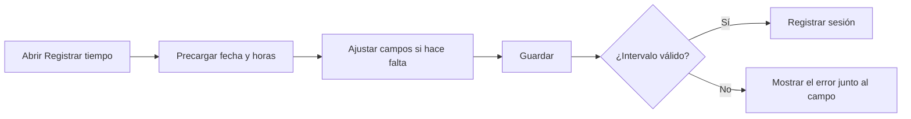

# CHG-188 · Precargar el registro manual en Pomodoro
**Estado:** En verificación
**Nivel:** S
**Modelo sugerido:** estandar
<!-- Estados y nivel se cambian SOLO con node .claude/team.mjs. Modelo: un perfil de docs/TEAM_MODELS.md -->
**Creado:** 2026-11-23 · **Aprobado:** 2026-11-23 · **Cerrado:** —
**Relacionado:** —

## 0. En palabras simples

Abre «Registrar tiempo» en Pomodoro. Si son las 15:30, podrás guardar de inmediato un registro de 15:05 a 15:30. Si necesitas otro intervalo, edita los campos antes de guardar.

## 1. Resumen

Reducir los ajustes necesarios para registrar manualmente una sesión de Pomodoro. La fecha y las horas se proponen cada vez que se abre el formulario de creación.

## 2. Producto

- Al abrir, ambas fechas corresponden al día actual en la zona horaria de Pomodoro. El fin se precarga con la hora actual al minuto y el inicio con 25 minutos de anticipación, limitado a las 00:00 de ese día.
- A las 00:10 se propone de 00:00 a 00:10. Durante el primer minuto del día, ambas horas son 00:00 y se aplica la validación de duración positiva.
- El alcance cubre el alta manual del módulo Pomodoro. El panel de Inicio, las sesiones históricas y su editor conservan su comportamiento.

## 3. UX/UI

### 3.1 Experiencia

Plantilla: formulario modal canónico existente. Se abre desde la acción actual «Registrar tiempo» y conserva los campos de fecha y hora editables. Cambiar la fecha de Inicio actualiza la fecha de Fin y conserva ambas horas. La duración se recalcula cuando se editan las horas. La descripción sigue siendo opcional.



### 3.2 Presentación

Se reutilizan el diálogo, los campos y la distribución adaptable actuales. Ejemplo de apertura a las 15:30.

```text
Registrar tiempo
Inicio  [ Hoy · 15:05 ]     Fin  [ Hoy · 15:30 ]
Descripción (opcional) [                      ]
Duración calculada  25 min
                                  [ Guardar ]
```

### 3.3 Escritura

Si la fecha de Fin se edita directamente y difiere de la de Inicio, mostrar junto a Fin «Usa la misma fecha para el inicio y el fin». Mantener los textos del resto del formulario.

## 4. Diseño técnico

Calcular ambos valores a partir de un solo instante, en la zona horaria que usa Pomodoro, al abrir el modal para crear un registro en el módulo. Limitar el inicio a la medianoche de ese día. En las actualizaciones del formulario, sincronizar la fecha de Fin solo cuando cambie la fecha de Inicio. Mantener las horas introducidas por el usuario entre la apertura y el guardado.

Reutilizar el cálculo de duración y exigir en el servidor que ambos extremos sean del mismo día. Conservar las validaciones de formato, orden, tiempo transcurrido y límite de 16 horas. Preservar la ruta de guardado, el aislamiento por usuario y el comportamiento del componente compartido por el panel de Inicio.

## 5. Pruebas

- Con reloj fijo, comprobar la apertura a las 15:30, 00:00, 00:10 y 00:25, el guardado directo sin descripción cuando el intervalo sea válido y la precarga nueva al reabrir.
- Comprobar el recálculo al editar horas, la conservación de ambas horas al sincronizar las fechas y el rechazo del guardado con fechas distintas. Actualizar la prueba existente que permite un alta cruzando medianoche. Cubrir el límite de 16 horas con fechas iguales.
- Ejecutar `php artisan test --filter='PomodoroTimerTest|PanelFocusSessionTest'` y `php artisan ui:conformance`.
- Comprobar en escritorio y móvil la apertura, el cambio de fecha, la edición de horas, los errores junto al campo y el guardado.

## 6. Documentación

Este CHG documenta el comportamiento y sus pruebas.

## 7. Tareas

- [x] T1 · Precargar y sincronizar las fechas y horas del registro manual — Resp: developer — Archivos: app/Livewire/Pomodoro/PomodoroTimer.php, resources/views/livewire/pomodoro/pomodoro-timer.blade.php — Hecho cuando: se puede guardar el intervalo precargado válido, editar los valores y el servidor rechaza fechas distintas.
- [x] T2 · Cubrir el registro manual y ejecutar las regresiones — Resp: developer — Archivos: tests/Feature/PomodoroTimerTest.php — Hecho cuando: las pruebas de Pomodoro y del panel de Inicio pasan y se registra el resultado de conformidad de UI.
- [ ] T3 · Verificar la interacción del modal y registrar evidencia — Resp: qa-tester — Archivos: este CHANGE.md — Hecho cuando: se comprueban los criterios del formulario en escritorio y móvil.

## 8. Bitácora de implementación (developer)

- T1 · El modal del módulo propone el intervalo al abrir, sincroniza las fechas al cambiar Inicio y valida el mismo día al guardar. Chromium confirmó precarga, sincronización, duración, mensaje de error y guardado a 1440 y 390 px sobre SQLite de pruebas.
- T2 · 28 pruebas y 280 aserciones correctas con `php artisan test --filter='PomodoroTimerTest|PanelFocusSessionTest|TaskListQuickActionsTest'` usando el controlador SQLite en la configuración temporal de PHP. Sintaxis PHP y `git diff --check` correctos. Conformidad de UI reportó tres incumplimientos ajenos al cambio en `day-tile-info.blade.php`, `game-collection.blade.php` y `checkin-sheet.blade.php`.
- La versión local del CLI de Team carece de `context` y `activity`. Se consultaron las guías del repositorio y se registró la evidencia en esta bitácora.

## 9. Preguntas abiertas, decisiones e historial

- 2026-11-23 — Creado en to-do/ (Borrador, nivel S)
- LECCIÓN: ninguna.
- 2026-11-23 — Aprobado por el usuario (Compuerta 2)
- 2026-11-23 — Movido a in-progress/ (En desarrollo)
- 2026-11-23 — Implementación terminada → En verificación
