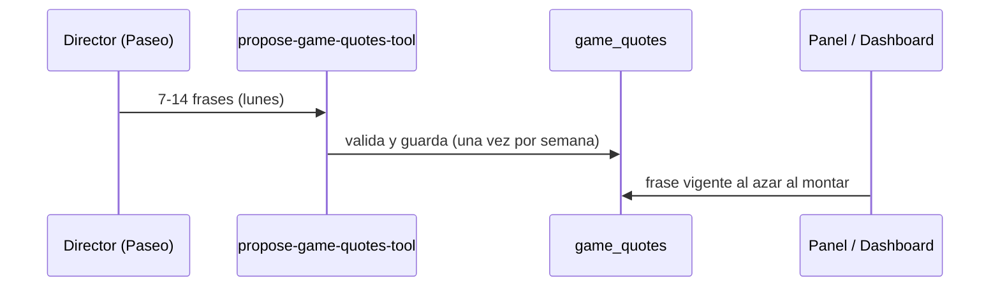

# CHG-043 · Integrante del dia con frase en panel y dashboard
**Estado:** Aprobado
**Nivel:** M
**Modelo sugerido:** estandar
<!-- Estados y nivel se cambian SOLO con node .claude/team.mjs. Modelo: un perfil de docs/TEAM_MODELS.md -->
**Creado:** 2026-11-09 · **Aprobado:** 2026-11-09 · **Cerrado:** —
**Relacionado:** CHG-026 (misiones del director vía MCP), CHG-033 (carta coleccionable)

## 0. En palabras simples
- Qué vas a ver distinto: al abrir el panel de pared o el dashboard aparece uno de tus Pokémon descubiertos, elegido al azar, con su nivel y una frase cálida. Cada vez que recargas la página sale otro. Las frases las renueva el director IA cada lunes.
- Cómo comprobarlo tú: recarga el panel 3 veces → cambia el integrante (si tienes más de uno). Espera la actualización automática del panel → no cambia. Toca la tarjeta → se abre su ficha.

## 1. Resumen
Una tarjeta "compañero" en el panel de pared (franja Ahora) y en el dashboard, con un ejemplar aleatorio del usuario y una frase de un catálogo en BD. El director agrega frases nuevas cada lunes vía una herramienta MCP; las viejas se retiran solas.

## 2. Producto (product-manager)
- Problema / usuario: la colección solo se ve entrando a `/game`; Alex quiere verla a diario en el tablero con un mensaje motivador que no se repita siempre.
- Incluye: tarjeta en panel y dashboard; tabla de frases con 30 semilla; herramienta MCP `propose-game-quotes-tool`; retiro automático de frases del director con más de 60 días; estado vacío.
- No incluye: frases personalizadas con datos del usuario, elegir favorito, cambiar el integrante con la actualización automática del panel.
- Criterios de aceptación (Dado/Cuando/Entonces):
  1. Dado que tengo ejemplares, cuando cargo panel o dashboard, entonces veo uno al azar con arte, nombre, nivel y una frase vigente.
  2. Cuando el panel se actualiza solo, entonces el integrante y la frase no cambian.
  3. Dado que no tengo ejemplares, entonces veo "Abre tu primera ball para conocer a tu compañero." con enlace a Balls.
  4. Con el juego apagado, la tarjeta no aparece.
  5. Cuando el director envía 7 a 14 frases válidas, se guardan como vigentes; con otra cantidad, longitud > 140 o palabras prohibidas ("debes", "obligatorio", "atrasado", "fallaste", "castigo"), se rechaza todo con motivos.
  6. Una segunda propuesta la misma semana responde `ya_propuestas` y no guarda nada.
  7. Las frases del director con más de 60 días no se eligen; las semilla siempre son elegibles.
  8. Tocar la tarjeta abre la ficha (`/game?species={id}`).

## 3. UX/UI
### 3.1 Experiencia (ux-designer)
- Flujo y cantidad de pasos: 0 pasos para verla; 1 clic para abrir la ficha.
- Contenido: arte (o marcador neutro), nombre, "Nv {n}", frase entre comillas. Lo más importante: la frase.
- Estados: con ejemplar; vacío (invitación); juego apagado (oculto). Sin carga visible: se resuelve en el render.
- Información necesaria: ninguna adicional.
- Accesibilidad: la tarjeta es un enlace con `aria-label="Ver ficha de {nombre}"`; la frase es texto real.

Panel de pared (franja Ahora):
```
┌ Ahora ──────────────────────────────────────────────┐
│ 07:42  lun 9 nov · Mañana        ◯ ◯ ◯ ◯  anillos   │
│                                ┌──────────────────────┐│
│                                │ [arte] Gotin · Nv 12 ││
│                                │ "Paso a paso también ││
│                                │  se llega lejos."    ││
│                                └──────────────────────┘│
└─────────────────────────────────────────────────────┘
```
Dashboard (primera fila de la cuadrícula, ancho completo en móvil):
```
┌───────────────────────────────────────────────┐
│ [arte]  Gotin · Nv 12                          │
│         "Paso a paso también se llega lejos."  │
└───────────────────────────────────────────────┘
Vacío:
┌───────────────────────────────────────────────┐
│ [ball]  Abre tu primera ball para conocer a    │
│         tu compañero.            [Ir a Balls]  │
└───────────────────────────────────────────────┘
```

### 3.2 Visual (ui-designer)
- Distribución: componente nuevo `x-game.daily-buddy` con variantes `wall` (compacta, texto grande legible a distancia) y `card` (dashboard).
- Componentes a reutilizar: `SpeciesImageProvider` para el arte, colores de tipo `game-type--{slug}` como acento del borde (resources/css/m3/modules/_game.css), `md-card-elevated`.
- Jerarquía: frase `md-body-large` (panel: `md-title-medium`); nombre y nivel `md-label-large`. Arte 64 px en dashboard, 96 px en panel.
- Responsive y contraste: en el panel no desplaza los anillos (se apila debajo en anchos < 1200 px); contraste AA sobre el acento de tipo.

### 3.3 Escritura (ux-writer)
- Ubicación y estado: tarjeta en panel y dashboard.
- Textos finales: "{Nombre} · Nv {nivel}"; frase entre comillas tipográficas “…”; vacío "Abre tu primera ball para conocer a tu compañero." con acción "Ir a Balls"; aria-label "Ver ficha de {nombre}".
- Reglas aplicadas: tuteo, cálido, sin culpa; frases ≤ 140 caracteres.
- Criterios de aceptación de los textos: las 30 frases semilla cumplen el validador.

## 4. Diseño técnico (software-architect)

- Archivos a crear / modificar:
  - Migración `create_game_quotes_table`: `id`, `user_id` (nullable = semilla global), `text` (≤140), `source` (`seed`|`director`), `week_start` (nullable), timestamps; índice `(user_id, created_at)`.
  - Seeder `GameQuoteSeeder` con 30 frases semilla (`user_id` null).
  - `app/Models/Game/GameQuote.php`.
  - `app/Services/Game/DailyBuddy.php`: `pick(int $userId): ?array` → ejemplar aleatorio (`GameCompanion` del usuario, `inRandomOrder`) + frase aleatoria vigente (semilla o del usuario con `created_at >= now-60d`). Devuelve null si el juego está apagado.
  - `app/Services/Game/QuoteValidator.php` (cantidad 7-14, ≤140, palabras prohibidas compartidas con la validación de misiones; reusar la lista si ya existe en código).
  - `app/Mcp/Tools/Game/ProposeGameQuotesTool.php`, registrada en `app/Mcp/Servers/LifeTrackerServer.php`. Respuestas: `ok`, `rejected` (errores), `ya_propuestas` (ya hay frases del director con `week_start` de esta semana), `director_paused`. Bloqueo por usuario como en `ProposeGameWeekMissionsTool`.
  - `get-game-director-context-tool`: agrega `quotes_due` (bool) y `quotes_limits`.
  - `resources/views/components/game/daily-buddy.blade.php`.
  - `app/Livewire/Home/WallPanel.php` y `resources/views/livewire/home/wall-panel.blade.php`: elegir en `mount()` y guardar en propiedad pública `$buddy` (las actualizaciones automáticas no la recalculan).
  - `app/Livewire/Home/Dashboard.php` y `resources/views/livewire/home/dashboard.blade.php`: igual.
- Enfoque y patrones: mismos patrones de validación estricta y respuestas idempotentes de `ProposeGameWeekMissionsTool`/`SeasonValidator`.
- Riesgos y mitigación: costo de `inRandomOrder` es trivial (≤ cientos de filas por usuario). La frase nunca incluye datos personales: el contexto del director no se amplía con datos nuevos.
- Qué NO tocar: lógica de recompensas, refresco del panel.

## 5. Pruebas (qa-tester)
| Caso | Tipo | Nivel | Test |
|---|---|---|---|
| Panel/dashboard muestran ejemplar y frase | Feature | Alto | tests/Feature/Game/DailyBuddyTest.php |
| Refresco del panel conserva integrante | Feature | Alto | DailyBuddyTest |
| Estado vacío y juego apagado | Feature | Medio | DailyBuddyTest |
| Frases del director > 60 días no se eligen; semilla sí | Unit | Medio | tests/Unit/Game/DailyBuddyServiceTest.php |
| Herramienta MCP: ok, rejected, ya_propuestas, director_paused | Feature | Alto | tests/Feature/Game/ProposeGameQuotesToolTest.php |
| Semilla pasa el validador | Unit | Bajo | tests/Unit/Game/QuoteValidatorTest.php |
- Comando para verificar: `php artisan test tests/Feature/Game tests/Unit/Game tests/Feature/Home`
- Regresión a vigilar: carga y refresco del panel de pared; dashboard.

## 6. Documentación (tech-writer)
- Docs a actualizar: `docs/game.md` → "Integrante del día" y la herramienta en "Director y temporadas", con el paso de frases en el prompt sugerido del schedule de Paseo.

## 7. Tareas
- [ ] T1 · Catálogo de frases con 30 semilla y elección de integrante + frase al azar — Resp: developer — Archivos: database/migrations/*_create_game_quotes_table.php, database/seeders/GameQuoteSeeder.php, app/Models/Game/GameQuote.php, app/Services/Game/DailyBuddy.php, app/Services/Game/QuoteValidator.php, tests/Unit/Game/DailyBuddyServiceTest.php, tests/Unit/Game/QuoteValidatorTest.php — Hecho cuando: los tests unitarios pasan y la semilla valida
- [ ] T2 · La tarjeta aparece en el panel de pared y en el dashboard y no cambia con el refresco — Resp: developer — Archivos: resources/views/components/game/daily-buddy.blade.php, app/Livewire/Home/WallPanel.php, resources/views/livewire/home/wall-panel.blade.php, app/Livewire/Home/Dashboard.php, resources/views/livewire/home/dashboard.blade.php, resources/css/m3/modules/_game.css, tests/Feature/Game/DailyBuddyTest.php — Hecho cuando: los criterios 1-4 y 8 pasan
- [ ] T3 · El director puede agregar frases cada lunes por MCP — Resp: developer — Archivos: app/Mcp/Tools/Game/ProposeGameQuotesTool.php, app/Mcp/Servers/LifeTrackerServer.php, app/Mcp/Tools/Game/GetGameDirectorContextTool.php, tests/Feature/Game/ProposeGameQuotesToolTest.php — Hecho cuando: los criterios 5-7 pasan
- [ ] T4 · Verificar criterios de aceptación — Resp: qa-tester — Hecho cuando: los 8 criterios pasan y las suites están en verde
- [ ] T5 · Actualizar documentación y prompt del director — Resp: tech-writer — Archivos: docs/game.md — Hecho cuando: docs al día

## 8. Bitácora de implementación (developer)

## 9. Preguntas abiertas, decisiones e historial
- 2026-11-09 — Creado en to-do/ (Borrador, nivel M)
- 2026-11-09 — Decisiones (Alex): panel de pared y dashboard; cambia solo al recargar la página; en la franja Ahora; el director agrega 7-14 frases cada lunes y se retiran a los 60 días; frases generales sin datos personales.
- 2026-11-09 — Aprobado por el usuario (Compuerta 2)
