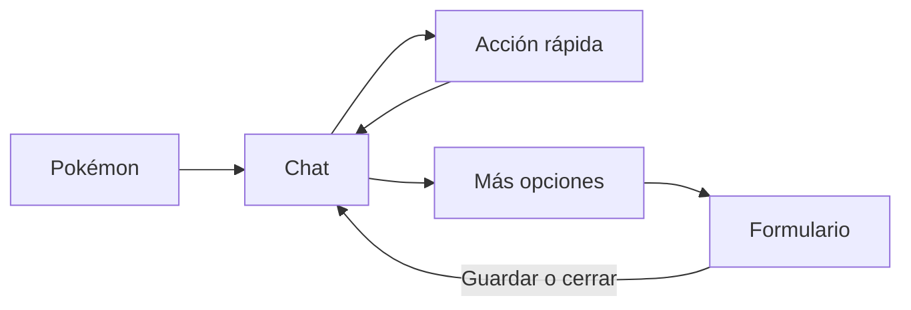

# CHG-106 · Restaurar chat y cierre de superficies en Android
**Estado:** Borrador
**Nivel:** M
**Modelo sugerido:** estandar
<!-- Estados y nivel se cambian SOLO con node .claude/team.mjs. Modelo: un perfil de docs/TEAM_MODELS.md -->
**Creado:** 2026-11-14 · **Aprobado:** — · **Cerrado:** —
**Relacionado:** CHG-098, CHG-100, CHG-101; coordinación con CHG-105 y CHG-109

## 0. En palabras simples
En Android, tocar el Pokémon abrirá el chat y sus opciones abrirán los formularios. Podrás guardar/cerrar sin quedarte atrapado en una hoja inferior. Compruébalo con Más opciones y con los controles de cierre y Atrás.

## 1. Resumen
Corrección P1 vinculada a CHG-098/100/101. El usuario precisó que el chat falla solo en Android; la PWA funciona. Las hojas inferiores atascadas se investigan en el mismo ciclo de superficies. No atribuirlo a ausencia de interfaz: el chat ya existe en el componente compartido.

## 2. Producto (product-manager)
- Incluye: launcher, acciones, formularios, cierre, teclado y Atrás, entrada directa y navegación Livewire.
- Excluye: IA, nuevas rápidas, notificaciones FCM, migraciones y ajustes de escala/barras (CHG-109).
- CA1: con presentación Pokémon y favorito/fallback vigente, el launcher abre un único chat interactivo, también al cambiar de módulo y regresar.
- CA2: rápidas existentes de Tareas/Agua/Ánimo funcionan, validan y confirman sin doble envío; otros módulos abren sus formularios/acciones vigentes.
- CA3: Más opciones transfiere el borrador al formulario correcto; guardar/cerrar no deja superficies invisibles capturando toques.
- CA4: con teclado abierto, Atrás lo oculta primero; después cierra la superficie superior según CHG-101. Con cambios pendientes conserva confirmación; no cierra dos superficies ni navega debajo.
- CA5: tres ciclos de abrir/cerrar y navegar no duplican chat/listeners ni conservan propietario Livewire obsoleto.
- CA6: Tradicional y sin compañero conservan FAB; Chrome/PWA y escritorio no sufren regresión.

## 3. UX/UI
### 3.1 Experiencia (ux-designer)
Plantilla: módulo existente + chat no modal + formulario modal canónico.
Conservar flujo/textos. El chat no atrapa foco como modal; al abrir formulario manda ese formulario. El cierre recupera contexto y foco apropiados.

### 3.2 Visual (ui-designer)
Restaurar diseño vigente, sin variante visual exclusiva Android.
```text
Escritorio                   Android / móvil
[Chat del compañero  X]      [Chat del compañero      X]
[Hilo y acciones]            [Hilo y acciones]
[Entrada] [Enviar]           [Entrada]        [Enviar]
[Más opciones]               [Más opciones]
                 [Pokémon]   [Pokémon] / teclado al escribir
```
Reutilizar ui/companion-chat, ui/fab, _companion-chat.css y tokens de tipo. Formularios encima del chat y navegación; teclado no tapa acciones. Ninguna capa invisible intercepta el launcher.
### 3.3 Escritura (ux-writer)
No aplica — conservar config/companion_chat.php, errores y etiquetas. No prometer persistencia de borrador que el código no garantice.

## 4. Diseño técnico (software-architect)
- Evidencia: ui/fab selecciona companion-chat; companion-chat.js registra hosts por módulo, mueve el host a body y mantiene this.wire. MainActivity tiene JavaScript/DOM storage; Atrás usa NativeBridge y protector web. Son puntos de inspección, no causas demostradas.
- Fuentes web: resources/js/companion-chat.js, ui-surfaces.js, navigation-guard.js, android.js; resources/views/components/ui/companion-chat.blade.php y fab.blade.php; resources/css/m3/patterns/_companion-chat.css. Nativas: Android/app/src/main/java/com/edwinortizp/lifetracker/MainActivity.kt y NativeBridge.kt.
- Reproducir con APK/build web, Android y System WebView identificados y cuenta ficticia; comparar mismo contenido en Chrome/PWA. Inspeccionar consola, hit target, capas, host conectado, propietario Livewire, pila y viewport antes de modificar capacidades.
- Corregir únicamente la capa demostrada: instancia única por módulo, referencia vigente al propietario y limpieza simétrica al abandonar/desmontar. Conservar hilo/borrador ante morph legítimo; no duplicar listeners al navegar.
- Mantener puente v1, origen HTTPS/frame principal, aislamiento por usuario, validaciones y restricciones TLS/cookies. No ampliar permisos o API nativa para abrir un panel DOM. Sin cambios de esquema/endpoints.
- Instrumentadas usan página sintética local con base URL del origen permitido. Integración autenticada usa entorno HTTPS de pruebas y cuenta ficticia; no crear registros en producción ni rutas de test públicas.
- Si comparte causa con CHG-105, implementar arreglo común una vez y ejecutar ambas regresiones. Insets/escala se coordinan con CHG-109.

## 5. Pruebas (qa-tester)
| Caso | Evidencia requerida |
|---|---|
| Tareas, Agua, Ánimo y Pomodoro | Toque abre chat/acción y cierre funciona |
| Tareas → Agua → Tareas con wire:navigate | Host único y acciones del módulo correcto |
| Rápida, Más opciones, error de red | Sin duplicación, borrador conservado y validación |
| Teclado y Atrás, formulario modificado | Orden CHG-101 y confirmación respetados |
| Tres ciclos, orientación y reanudación | Sin bloqueo invisible de interacción/scroll |
| Tradicional/sin colección y PWA | FAB y comportamiento de referencia preservados |
- Ampliar tests/JavaScript/companion-chat.test.js, navigation-guard.test.js, tests/Browser/companion-chat.interaction.spec.js y Android/app/src/androidTest/java/com/edwinortizp/lifetracker/ShellInstrumentedTest.kt según defecto reproducido.
- Comandos: php artisan test --filter=CompanionChatTest; node --test tests/JavaScript/companion-chat.test.js tests/JavaScript/navigation-guard.test.js; npx playwright test --config=tests/Browser/companion-chat.config.js; npm run build; php artisan ui:conformance; ./Android/gradlew.bat -p Android testDebugUnitTest assembleDebug lintDebug connectedDebugAndroidTest --console=plain.
- Revisar 390×844 y 1440×900, axe y movimiento reducido. Exigir chat autenticado en Android físico y registrar teclado/versiones/APK. Login público o emulación no certifican ese recorrido; sin teléfono queda En verificación.

## 6. Documentación (tech-writer)
Actualizar docs/companion-chat.md si cambia ciclo de vida, docs/design-system.md si cambia contrato y Android/README.md con reproducción/compatibilidad. §8 registra causa y límites sin anunciar despliegue.

## 7. Tareas
- [ ] T1 · Identificar por qué chat y hojas no responden en Android — Resp: developer — Modelo: estandar — Archivos: tests/Browser/companion-chat.interaction.spec.js, Android/app/src/androidTest/java/com/edwinortizp/lifetracker/ShellInstrumentedTest.kt, CHANGE.md — Hecho cuando: reproducción identifica build y capa responsable comparando Chrome/PWA.
- [ ] T2 · Restaurar apertura, acciones y cierre — Resp: developer — Modelo: estandar — Archivos: resources/js/companion-chat.js, resources/js/ui-surfaces.js, resources/js/navigation-guard.js, resources/js/android.js, resources/views/components/ui/companion-chat.blade.php, resources/views/components/ui/fab.blade.php, resources/css/m3/patterns/_companion-chat.css, Android/app/src/main/java/com/edwinortizp/lifetracker/MainActivity.kt, Android/app/src/main/java/com/edwinortizp/lifetracker/NativeBridge.kt, pruebas afectadas — Hecho cuando: CA1–CA6 pasan en entorno reproducido modificando solo piezas justificadas por T1.
- [ ] T3 · Comprobar chat autenticado y hojas en Android físico — Resp: qa-tester — Archivos: CHANGE.md, evidencias en storage/framework/testing — Hecho cuando: matriz §5 ejecutada y validaciones físicas diferenciadas de emulación.
- [ ] T4 · Documentar compatibilidad y recuperación — Resp: tech-writer — Archivos: docs/companion-chat.md, docs/design-system.md, Android/README.md, CHANGE.md — Hecho cuando: contratos y evidencia coinciden con implementación.

## 8. Bitácora de implementación (developer)
Sin implementación; completar al desarrollar.

## 9. Preguntas abiertas, decisiones e historial
- 2026-11-14 — Creado en to-do/ (Borrador, nivel M) mediante team new.
- 2026-11-14 — Usuario solicita completar especificaciones; sin aprobar implementación.
- Triage: M, P1, estandar; QA y arquitectura por interacción web/nativa.
- Reporte confirmado: chat falla solo en Android; causa técnica pendiente de reproducción obligatoria T1.
- Backlogs UX/UI revisados; sin ítem equivalente. Sin decisiones de producto abiertas para el borrador.
- CHG-098/100/101 están Cerrados; registrar corrección nueva sin alterar su historial.
- LECCIÓN: ninguna nueva antes de reproducir/corregir.
- 2026-11-14 — Línea base local: PHP filtrado PanelFocusSessionTest/PomodoroTimerTest/CompanionChatTest/TaskEditorDraftTest: 43 pruebas, 304 aserciones, todas pasan; JS pomodoro-timer/dialog-viewport/navigation-guard/companion-chat: 27 pruebas, todas pasan. No reproduce ni certifica los reportes físicos.
- Perfil estandar sin proveedor configurado en docs/TEAM_MODELS.md; no elegir proveedor externo implícitamente. Bocetos y causa están pendientes de revisión/validación según las tareas, no de redacción.
