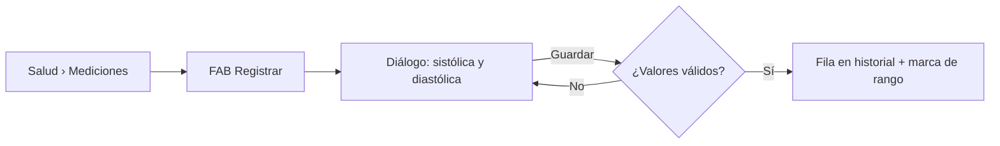

# CHG-122 · Salud: base de mediciones y presión arterial
**Estado:** Aprobado
**Nivel:** M
**Modelo sugerido:** estandar
<!-- Estados y nivel se cambian SOLO con node .claude/team.mjs. Modelo: un perfil de docs/TEAM_MODELS.md -->
**Creado:** 2026-11-16 · **Aprobado:** 2026-11-16 · **Cerrado:** —
**Relacionado:** CHG-123, CHG-124, CHG-125, CHG-126, CHG-127, CHG-128

## 0. En palabras simples
- Qué vas a ver distinto: en Salud aparece una pestaña «Mediciones» donde guardas tu presión arterial (sistólica y diastólica) con fecha y hora, ves tu historial y recibes un aviso neutro si un valor sale del rango de referencia. MiSo registra y muestra tendencias; no diagnostica.
- Cómo comprobarlo tú: entra a Salud → Mediciones, registra «120/80», mira que aparezca en el historial; registra «160/100» y comprueba que se marque como fuera de rango con la invitación a consultar a tu profesional de salud.

## 1. Resumen
Hoy Salud solo guarda eventos (citas, síntomas, vacunas) y seguimiento de intensidad; no hay valores medidos con unidad. Este CHG crea la base común para todas las mediciones: la tabla `health_measurements`, un catálogo de tipos con unidad y rango de referencia, el formulario de captura, el historial, el aviso «MiSo no es un dispositivo médico» y las herramientas MCP genéricas. La presión arterial es la primera métrica y valida el esqueleto; glucosa, creatinina, peso, etc. se agregan después como entradas del catálogo (CHG-123, 124, 127).

## 2. Producto (product-manager)
- Problema / usuario: la persona quiere llevar en MiSo sus mediciones de salud y ver su evolución, y hoy no tiene dónde.
- Incluye:
  - Registrar, editar y eliminar mediciones de presión arterial (sistólica, diastólica, pulso opcional, notas).
  - Historial con filtro por fecha.
  - Marca neutra de «fuera del rango de referencia».
  - Aviso «no es dispositivo médico» visible en la pestaña.
  - Herramientas MCP `log-health-measurement-tool` y `list-health-measurements-tool`.
- No incluye: diagnóstico, recomendaciones de tratamiento, recordatorios o alertas programadas, gráficas de tendencia (CHG-128), otras métricas (CHG-123 a 127), importación desde dispositivos.
- Criterios de aceptación (Dado/Cuando/Entonces):
  - CA1. Dado un usuario autenticado, cuando registra 120/80 mmHg, entonces queda guardada con su fecha y hora y aparece en su historial.
  - CA2. Dado un valor fuera del rango de referencia, cuando se muestra, entonces lleva una marca informativa sin lenguaje de diagnóstico y con remisión al profesional de salud.
  - CA6. Dado una medición, cuando el asistente consulta por MCP sin pedirlo expresamente, entonces las mediciones marcadas como sensibles no se devuelven; con `include_sensitive=true` sí.
  - CA3. Dado otro usuario, cuando consulta sus mediciones por UI o MCP, entonces nunca ve las del primero.
  - CA4. Dado un valor imposible (diastólica mayor que sistólica, o fuera de límites fisiológicos), cuando guarda, entonces se rechaza con un mensaje que indica qué corregir.
  - CA5. Dado el asistente vía MCP, cuando registra una presión, entonces el resultado coincide con el de la UI.

## 3. UX/UI
<!-- Sin pantallas: escribe "No aplica — motivo" en cada parte. Con UI, approve exige un boceto ASCII en un bloque de código. Si hay flujo, agrega un diagrama en un bloque mermaid. -->
### 3.1 Experiencia (ux-designer)
- Plantilla: pestaña nueva «Mediciones» del módulo Salud (patrón de módulo con pestañas de `config/modules.php`, como las pestañas de Agua). No existe una plantilla específica en `## Anatomía` de docs/UX-DESIGN.md.
- Flujo y cantidad de pasos: Salud → pestaña «Mediciones» → FAB «Registrar» → diálogo (sistólica, diastólica, listo) → «Guardar». Son 2 pasos y 3 campos obligatorios; la fecha y hora vienen en «ahora» y el pulso y las notas van plegados en «Más detalle» (UX-003). Editar: toque en la fila abre el mismo diálogo. Eliminar pide confirmación que nombra el valor.
- Qué contiene cada pantalla y qué es lo más importante: primero la **última medición** con su marca de rango (lo que la persona quiere ver al abrir), después el registro rápido (FAB) y al final el historial. En móvil el orden es el mismo (UX-002).
- Estados (vacío / carga / error / éxito / validaciones):
  - Vacío: invitación a registrar la primera medición con el FAB. Vacío por filtro: «Sin mediciones en este periodo» con «Limpiar filtros». Carga: esqueleto de la tarjeta. Error al guardar: mensaje sereno y el formulario conserva lo escrito.
  - Éxito: el diálogo se cierra y la fila nueva aparece arriba del historial con la marca de rango si aplica.
  - Validaciones en el servidor al guardar, con `validation-state="submitted"`; aviso de «cambios sin guardar» al cerrar con datos escritos.
- Información necesaria y momento de presentación: el aviso «no es un dispositivo médico» va visible bajo el título de la pestaña, una línea, sin acordeón. El rango de referencia se muestra junto al valor solo cuando está fuera de rango; la explicación secundaria va en un botón de ayuda con nombre accesible.
- Accesibilidad de uso (teclado, foco, errores): el diálogo atrapa el foco y lo devuelve al FAB; los errores se asocian al campo y se anuncian; la marca de rango nunca depende solo del color (ícono + texto); unidades siempre visibles en texto («mmHg»).



Boceto escritorio:

```
┌ Salud ▸ Registro | Vista del cuerpo | Mediciones ───────────────────────┐
│ MiSo registra tus mediciones y muestra su evolución. No es un          │
│ dispositivo médico ni reemplaza a tu profesional de salud.             │
│                                                                        │
│ ┌ Última medición ───────────────────────────────────────────────┐     │
│ │ ❤ Presión arterial        128 / 84 mmHg   · hoy 08:10          │     │
│ │ ⓘ Por encima del rango de referencia general (menos de 120/80) │     │
│ └────────────────────────────────────────────────────────────────┘     │
│ ┌ Historial (12) ─ [Buscar] [Orden ▾] [Filtros ▾] ───────────────┐     │
│ │ Fecha        Hora   Medición        Valor         Estado    ⋮  │     │
│ │ Hoy          08:10  Presión arterial 128/84 mmHg  ⓘ Fuera    ⋮  │     │
│ │ 15 nov 2026  21:30  Presión arterial 118/76 mmHg  En rango   ⋮  │     │
│ └────────────────────────────────────────────────────────────────┘     │
│                                                              (＋ FAB)  │
└────────────────────────────────────────────────────────────────────────┘
```

Boceto móvil (el diálogo ocupa la pantalla):

```
┌ Mediciones ────────────┐   ┌ Registrar medición ──── ✕ ┐
│ MiSo no es un          │   │ Tipo   [Presión arterial ▾]│
│ dispositivo médico… ⓘ  │   │ Sistólica      [ 120 ] mmHg│
│ ┌ Última ────────────┐ │   │ Diastólica     [  80 ] mmHg│
│ │ 128/84 mmHg · hoy  │ │   │ Fecha y hora   [Ahora    ▾]│
│ │ ⓘ Fuera de rango   │ │   │ ▸ Más detalle (pulso, notas)│
│ └────────────────────┘ │   │ [Cancelar]        [Guardar]│
│ Historial              │   └────────────────────────────┘
│ Hoy 08:10  128/84  ⓘ   │
│ 15 nov     118/76      │
│                  (＋)  │
└────────────────────────┘
```

### 3.2 Visual (ui-designer)
- Distribución: `x-module-shell module="health"`; tarjeta «Última medición», luego `x-ui.management-card` con el historial (tabla `md-table--stack` en móvil, como `water-daily.blade.php`). Acción primaria con `x-module-actions` («Registrar», `bi-plus-lg`), que usa el FAB y `x-ui.form-dialog`.
- Componentes existentes a reutilizar (ruta): `resources/views/livewire/water/water-daily.blade.php` (patrón de tarjeta, filtros y tabla), `x-ui.management-card`, `x-ui.field`, `x-ui.select`, `x-ui.applied-filters`, `App\Support\Ui\DataState` para los estados, y el acento del módulo desde `config/modules.php` (`data-module`, `--md-module-accent`).
- Jerarquía, color, tipografía y espaciado (tokens): el valor de la última medición en `md-title-large`; la unidad y la fecha en `md-body-medium`. La marca «fuera de rango» usa el tono informativo del sistema con ícono `bi-info-circle` y texto, nunca rojo de error: no es una falla. Sin tonos ni íconos elegidos a mano.
- Responsive y contraste: tabla apilada bajo el breakpoint de móvil; el panel no tiene columna lateral. Contraste AA para la marca de rango en claro y oscuro; objetivos táctiles de 44 px. Validar con captura en escritorio y móvil con 0, pocos y muchos registros (`docs/TESTING.md`).

### 3.3 Escritura (ux-writer)
- Ubicación y estado: aviso bajo el título de la pestaña; marca de rango en la tarjeta y en cada fila; mensajes de validación junto al campo.
- Textos finales (variables y variantes):
  - Aviso: «MiSo registra tus mediciones y muestra su evolución. No es un dispositivo médico ni reemplaza a tu profesional de salud.»
  - Fuera de rango: «Fuera del rango de referencia general ({rango} {unidad}). Si te preocupa, consúltalo con tu profesional de salud.» Fila corta: «Fuera de rango». En rango: «En rango».
  - Vacío: «Aún no tienes mediciones. Registra la primera con el botón +.» Vacío por filtro: «Sin mediciones en este periodo.»
  - Validaciones: «La sistólica debe estar entre 60 y 260 mmHg.», «La diastólica debe ser menor que la sistólica.», «El pulso debe estar entre 30 y 220 lpm.»
  - Eliminar: «Se eliminará la medición de {valor} {unidad} del {fecha}.»
  - Guardado: «Medición guardada.» Error: «No pudimos guardar la medición. Revisa tu conexión e inténtalo de nuevo.»
- Reglas de docs/UX-WRITING.md aplicadas: tuteo neutro; tono respetuoso y sin humor en salud; no se convierte el cuerpo en un juicio («fuera de rango» describe, no califica); validaciones sin culpar; eliminación explícita sobre qué se pierde; no se promete conservar datos ante errores.
- Criterios de aceptación de los textos: ninguno usa diagnóstico («hipertensión», «peligro», «normal/anormal»), ninguno da una indicación de tratamiento, y toda marca fuera de rango remite al profesional de salud.

## 4. Diseño técnico (software-architect)
- Archivos a crear / modificar:
  - Migración `create_health_measurements_table`: `uuid id`, `user_id`, `type`, `value`, `value2` nullable, `unit`, `measured_at`, `context` nullable, `notes`, `health_event_id` nullable (FK compuesta con `user_id`), `is_sensitive` boolean default false, `source`, `source_key`. Índice `[user_id, type, measured_at]` con nombre corto explícito.
  - `app/Models/HealthMeasurement.php` (`BelongsToUser`, `HasUuids`) con catálogo `TYPES` (etiqueta, unidad, límites fisiológicos, rango de referencia). Relación en `User`.
  - `app/Actions/LogHealthMeasurement.php` compartida entre UI y MCP (modelo: `LogDrink`).
  - `app/Livewire/Health/HealthMeasurements.php` y vista en `resources/views/livewire/health/`; ruta en `routes/web.php`; pestaña en `config/modules.php`.
  - MCP en `app/Mcp/Tools/Health/`; registro en `LifeTrackerServer`, `ToolCatalog::MODULES`, `DeleteEntryTool`, `GetRecentActivityTool`; morph map en `AppServiceProvider`.
- Enfoque y patrones a seguir: ver `EnergyEntry`/`DrinkLog` y `HealthModuleTest`. Validar en servidor.
- Riesgos y mitigación:
  - Un rango mal definido puede sonar a diagnóstico. Se muestra como «rango de referencia general», sin adjetivos clínicos.
  - Datos sensibles sin política de cifrado (ver §9).
- Qué NO tocar: `health_events`/`health_logs` y su escala de intensidad.

## 5. Pruebas (qa-tester)
| Caso | Tipo | Nivel | Test |
|---|---|---|---|
| Guardar y listar presión (CA1) | Feature | Livewire | `HealthMeasurementsTest` |
| Fuera de rango marcado (CA2) | Feature | Livewire | `HealthMeasurementsTest` |
| Sensibles ocultas en MCP salvo `include_sensitive` (CA6) | Feature | MCP | `LifeTrackerHealthMeasurementMcpTest` |
| Aislamiento entre usuarios (CA3) | Feature | Livewire + MCP | `HealthMeasurementsTest`, `LifeTrackerHealthMeasurementMcpTest` |
| Validación de límites (CA4) | Feature | Livewire | `HealthMeasurementsTest` |
| Paridad UI/MCP (CA5) | Feature | MCP | `LifeTrackerHealthMeasurementMcpTest` |
| Esquema por usuario | Feature | Esquema | `MultitenancySchemaTest` |
- Comando para verificar: `php artisan test --filter=HealthMeasurement`, `php artisan ui:conformance`, `npm run build`.
- Regresión a vigilar: `HealthModuleTest`, `LifeTrackerContextMcpTest`.

## 6. Documentación (tech-writer)
- Docs a actualizar: `docs/PRODUCT.md` (ya actualizado en la preparación de este CHG), `docs/UX-WRITING.md` (texto de fuera de rango), `docs/mockup-system/mockups/health/`.

## 7. Tareas
<!-- Primero lo que cambia para el usuario; el detalle técnico después. -->
- [ ] T1 · Registrar y ver presión arterial en Salud → Mediciones — Resp: developer — Modelo: estandar — Archivos: migración, `HealthMeasurement`, `LogHealthMeasurement`, `HealthMeasurements`, vista, ruta, `config/modules.php` — Hecho cuando: CA1, CA2 y CA4 pasan en pruebas.
- [ ] T2 · El asistente puede registrar y consultar mediciones — Resp: developer — Modelo: estandar — Archivos: `app/Mcp/Tools/Health/*`, `LifeTrackerServer`, `ToolCatalog`, `DeleteEntryTool` — Hecho cuando: CA3 y CA5 pasan en pruebas.
- [ ] T3 · Pruebas y verificación en móvil y escritorio — Resp: developer — Modelo: estandar — Archivos: `tests/Feature/*` — Hecho cuando: los comandos de §5 pasan.

## 8. Bitácora de implementación (developer)

## 9. Preguntas abiertas, decisiones e historial
- 2026-11-16 — Creado en to-do/ (Borrador, nivel M). Decisiones del usuario: un CHG por métrica sobre esta base; enfoque «registro y tendencias» (sin diagnóstico ni recordatorios); aviso «no es dispositivo médico».
- Decidido 2026-11-16: sin cifrado en la primera versión, para poder ordenar y promediar en SQL. Se reevalúa en CHG-126 (ciclo menstrual).
- Decidido 2026-11-16: las mediciones se marcan `is_sensitive` (patrón de `health_events`): las consultas amplias de MCP no las devuelven salvo `include_sensitive=true`.
- Decidido 2026-11-16: rangos de referencia fijos en la primera versión (constantes de `HealthMeasurement::TYPES`); configurables por persona queda para después.
- Nota: `docs/DOCUMENTATION.md` está citado en `CLAUDE.md` pero no existe.
- 2026-11-16 — Aprobado por el usuario (Compuerta 2)
