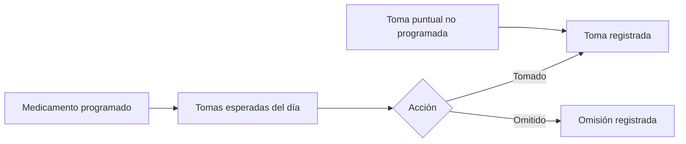

# CHG-129 · Salud: medicamentos tomados y por tomar (con MCP)
**Estado:** Borrador
**Nivel:** M
**Modelo sugerido:** estandar
<!-- Estados y nivel se cambian SOLO con node .claude/team.mjs. Modelo: un perfil de docs/TEAM_MODELS.md -->
**Creado:** 2026-11-16 · **Aprobado:** — · **Cerrado:** —
**Relacionado:** CHG-122 (aviso «no es dispositivo médico» y criterios de privacidad)

## 0. En palabras simples
- Qué vas a ver distinto: en Salud aparece «Medicamentos». Registras cada medicamento que debes tomar (nombre, dosis, cada cuánto y desde cuándo hasta cuándo) y marcas cada toma como «tomado» u «omitido». También puedes anotar un medicamento que tomaste sin tenerlo programado. Ves qué te toca hoy y qué ya tomaste. Todo esto también se puede registrar y consultar desde el asistente (MCP).
- Cómo comprobarlo tú: crea «Losartán 50 mg, 1 vez al día, mañana», verás una toma pendiente hoy; márcala como tomada y revisa que pase al historial. Pide al asistente «¿qué medicamentos me faltan hoy?» y «registra que tomé ibuprofeno 400 mg».

## 1. Resumen
Hoy MiSo no tiene medicamentos. Este CHG agrega dos conceptos: el **medicamento programado** (qué debo tomar y con qué frecuencia) y la **toma** (lo que realmente tomé u omití, con o sin programación). Con ellos se responde «¿qué he consumido?» y «¿qué debo consumir?». Se expone por UI y por MCP con la misma Action. No hay recordatorios ni alertas (decisión previa de enfoque «registro y tendencias»); MiSo no es un dispositivo médico y no recomienda dosis ni detecta interacciones.

## 2. Producto (product-manager)
- Problema / usuario: la persona toma medicamentos (tratamientos crónicos o cortos) y hoy no tiene dónde llevar qué tomó y qué le falta; esto también ayuda a explicar síntomas o energía.
- Incluye:
  - Alta, edición y baja (finalizar) de medicamentos programados: nombre, dosis y unidad, frecuencia, horarios sugeridos, fecha de inicio, fecha de fin opcional, indicaciones y notas.
  - Registro de tomas: tomado (con hora real), omitido (con motivo opcional) o toma puntual no programada.
  - Vista «Hoy»: pendientes, tomados y omitidos, y atrasados del día.
  - Historial con filtro por fecha y por medicamento.
  - MCP: registrar medicamento, registrar toma, consultar pendientes del día y consultar historial/consumo.
- No incluye: recordatorios o notificaciones, alertas de interacciones o dosis máximas, inventario/compra de medicamentos, recetas médicas adjuntas, integración con el inventario del módulo de alimentación.
- Criterios de aceptación (Dado/Cuando/Entonces):
  - CA1. Dado un medicamento «1 vez al día», cuando abro «Hoy», entonces veo una toma pendiente y, al marcarla tomada, pasa al historial con su hora.
  - CA2. Dado un medicamento con fecha de fin pasada o finalizado, cuando abro «Hoy», entonces no genera tomas pendientes, pero su historial se conserva.
  - CA3. Dado un medicamento no programado, cuando registro una toma puntual, entonces queda en el historial sin afectar los pendientes.
  - CA4. Dado el asistente vía MCP, cuando pregunta por los pendientes de hoy, entonces recibe la misma lista que la UI.
  - CA5. Dado el asistente vía MCP, cuando registra una toma con medicamento y dosis, entonces se crea igual que desde la UI (mismo Action) y devuelve confirmación con el estado de las pendientes.
  - CA6. Dado otro usuario, cuando consulta por UI o MCP, entonces nunca ve estos datos.
  - CA7. Dado un registro repetido (mismo medicamento y misma toma programada), cuando se reintenta, entonces no duplica (idempotente por clave de operación).

## 3. UX/UI
<!-- Sin pantallas: escribe "No aplica — motivo" en cada parte. Con UI, approve exige un boceto ASCII en un bloque de código. Si hay flujo, agrega un diagrama en un bloque mermaid. -->
### 3.1 Experiencia (ux-designer)
- Pendiente: flujo, boceto ASCII (escritorio y móvil), estados (sin medicamentos, nada pendiente hoy, todo tomado) y accesibilidad. Principio: marcar una toma debe costar un toque (UX-001 de `docs/backlog/UX-DESIGN.md`). Orden móvil: pendientes de hoy, registro rápido, historial (UX-002).

### 3.2 Visual (ui-designer)
- Pendiente. Reutilizar FAB + `x-ui.form-dialog`, `x-ui.management-card` y el acento del módulo salud.

### 3.3 Escritura (ux-writer)
- Pendiente. Tono respetuoso y sin humor (`docs/UX-WRITING.md`, salud). «Omitido» sin culpar. Incluir el aviso de que MiSo no sustituye la indicación del profesional de salud.

## 4. Diseño técnico (software-architect)
- Archivos a crear / modificar:
  - Migración `medications`: `uuid id`, `user_id`, `name`, `dose_amount` decimal, `dose_unit`, `form` (tableta, jarabe, inyección…), `frequency_type` (diaria, cada N horas, días de la semana, solo si es necesario), `times` json (horarios sugeridos HH:MM), `starts_on`, `ends_on` nullable, `instructions`, `notes`, `health_event_id` nullable (FK compuesta con `user_id`, para ligarlo a una enfermedad o cita), `is_active`. Índice `[user_id, is_active, starts_on]` con nombre corto.
  - Migración `medication_intakes`: `uuid id`, `user_id`, `medication_id` nullable (FK compuesta; null = toma puntual), `name` (copia para tomas puntuales o si se borra el medicamento), `dose_amount`, `dose_unit`, `scheduled_for` nullable (fecha-hora esperada), `taken_at` nullable, `status` (`taken`/`skipped`), `skip_reason`, `notes`, `source`, `operation_key`. `unique [user_id, operation_key]` y `unique [medication_id, scheduled_for]` para idempotencia.
  - Modelos `Medication` y `MedicationIntake` (`BelongsToUser`, `HasUuids`); relaciones en `User`; morph map en `AppServiceProvider`.
  - `app/Support/MedicationSchedule.php`: calcula las tomas esperadas de un día a partir de la frecuencia (lógica pura y testeable). Las tomas esperadas no se guardan por adelantado: se derivan y solo se persiste lo que ocurre.
  - `app/Actions/LogMedicationIntake.php`, compartida por UI y MCP.
  - `app/Livewire/Health/Medications.php` y vista; ruta en `routes/web.php`; pestaña en `config/modules.php` (módulo `health`).
  - MCP en `app/Mcp/Tools/Health/`: `LogMedicationTool` (alta/edición), `LogMedicationIntakeTool`, `ListMedicationsTool` (pendientes de hoy, activos, historial con `DateWindow`). Registro en `LifeTrackerServer` (y su texto de instrucciones), `ToolCatalog::MODULES`, `DeleteEntryTool`, `GetRecentActivityTool` y `GetHealthContextTool` (medicamentos activos y pendientes).
- Enfoque y patrones a seguir: `LogDrink` + `LogWaterIntakeTool` para la Action compartida y la confirmación; `operation_key` estable como en compras/comidas; tareas programadas no aplican.
- Riesgos y mitigación:
  - Zona horaria y «día» de la toma: usar la zona del usuario y probar el cambio de día.
  - Frecuencias complejas (cada 8 h, ciclos): limitar a diaria, N veces al día con horarios, cada N horas y días de la semana; lo demás, a CHG posterior.
  - Borrar un medicamento no debe perder el historial: la toma conserva su nombre.
  - Datos sensibles: seguir la decisión de privacidad de CHG-122 (cifrado y `is_sensitive` abiertos).
- Qué NO tocar: `health_events`/`health_logs`, inventario y compras.

## 5. Pruebas (qa-tester)
| Caso | Tipo | Nivel | Test |
|---|---|---|---|
| Pendientes del día según frecuencia (CA1, CA2) | Unitaria | Support | `MedicationScheduleTest` |
| Marcar tomada/omitida y toma puntual (CA1, CA3) | Feature | Livewire | `MedicationsModuleTest` |
| Paridad UI/MCP y pendientes (CA4, CA5) | Feature | MCP | `LifeTrackerMedicationMcpTest` |
| Aislamiento entre usuarios (CA6) | Feature | Livewire + MCP | ambos |
| Idempotencia por `operation_key` (CA7) | Feature | MCP | `LifeTrackerMedicationMcpTest` |
| Cambio de día y zona horaria | Unitaria | Support | `MedicationScheduleTest` |
| Esquema por usuario | Feature | Esquema | `MultitenancySchemaTest` |
- Comando para verificar: `php artisan test --filter=Medication`, `php artisan ui:conformance`, `npm run build`.
- Regresión a vigilar: `HealthModuleTest`, `LifeTrackerContextMcpTest`, `LifeTrackerMcpTest` (lista de herramientas).

## 6. Documentación (tech-writer)
- Docs a actualizar: `docs/PRODUCT.md` (módulo de salud), `docs/UX-WRITING.md` (textos de omisión y aviso), `docs/mockup-system/mockups/health/`.

## 7. Tareas
- [ ] T1 · Crear medicamentos y ver qué toca hoy — Resp: developer — Modelo: estandar — Archivos: migraciones, `Medication`, `MedicationSchedule`, `Medications`, vista, ruta, `config/modules.php` — Hecho cuando: CA1 y CA2 pasan en pruebas.
- [ ] T2 · Marcar tomas (tomado/omitido) y registrar tomas puntuales — Resp: developer — Modelo: estandar — Archivos: `MedicationIntake`, `LogMedicationIntake`, componente Livewire — Hecho cuando: CA3 pasa en pruebas.
- [ ] T3 · Registrar y consultar medicamentos desde el asistente (MCP) — Resp: developer — Modelo: estandar — Archivos: `app/Mcp/Tools/Health/*`, `LifeTrackerServer`, `ToolCatalog`, `DeleteEntryTool`, `GetRecentActivityTool`, `GetHealthContextTool` — Hecho cuando: CA4, CA5 y CA7 pasan en pruebas.
- [ ] T4 · Aislamiento, esquema y verificación en móvil y escritorio — Resp: developer — Modelo: estandar — Archivos: `tests/Feature/*` — Hecho cuando: CA6 y los comandos de §5 pasan.

## 8. Bitácora de implementación (developer)

## 9. Preguntas abiertas, decisiones e historial
- 2026-11-16 — Creado en to-do/ (Borrador, nivel M) a pedido del usuario: registrar lo consumido y lo que se debe consumir, con registro y consulta por MCP.
- Abierta: ¿se necesitan recordatorios? Se dejó fuera por la decisión previa de «registro y tendencias»; requeriría tareas programadas (`docs/DEPLOY.md`).
- Abierta: ¿frecuencias a soportar en la primera versión? Propuesta: diaria con horarios, cada N horas y días de la semana.
- Abierta: ¿ligar un medicamento a un evento de salud (enfermedad, cita) en la primera versión?
- Abierta: privacidad (cifrado, `is_sensitive` para MCP): se resuelve junto con CHG-122 y aplica igual aquí.
- Si crece, dividir en: (1) medicamentos y tomas por UI, (2) MCP.
