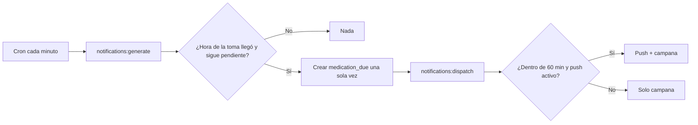

# CHG-130 · Salud: recordatorios de medicamentos con el cron existente
**Estado:** Borrador
**Nivel:** M
**Modelo sugerido:** estandar
<!-- Estados y nivel se cambian SOLO con node .claude/team.mjs. Modelo: un perfil de docs/TEAM_MODELS.md -->
**Creado:** 2026-11-16 · **Aprobado:** — · **Cerrado:** —
**Relacionado:** CHG-129 (depende de él: medicamentos y tomas)

## 0. En palabras simples
- Qué vas a ver distinto: a la hora de cada toma de un medicamento programado, MiSo te avisa en la campana de la app y, si lo tienes activado, con una notificación push. Si ya registraste la toma, no te avisa. En Ajustes → Notificaciones puedes apagar estos avisos.
- Cómo comprobarlo tú: crea un medicamento con una toma dentro de unos minutos; al llegar la hora recibes un solo aviso (aunque el servidor corra varias veces). Márcala como tomada antes de la hora y comprueba que no llega aviso.

## 1. Resumen
Agrega recordatorios a los medicamentos de CHG-129 reutilizando el sistema de notificaciones y el cron que ya existen (`schedule:run` → `notifications:generate` y `notifications:dispatch`, cada minuto). No se crea ningún cron ni proceso nuevo. Cada toma esperada genera como máximo una notificación `medication_due`, identificada por su hora, de modo que correr la tarea varias veces no duplica avisos. MiSo recuerda, no prescribe: no sugiere dosis ni cambia horarios.

## 2. Producto (product-manager)
- Problema / usuario: tomar un medicamento a tiempo se olvida con facilidad; registrar las tomas sin aviso depende de acordarse.
- Incluye:
  - Aviso a la hora de cada toma programada pendiente (campana en la app y push si está habilitado).
  - Ventana de vigencia de 60 minutos: pasada esa ventana el aviso no se envía por push.
  - Cancelación del aviso si la toma ya se registró (tomada u omitida) o si el medicamento se finalizó.
  - Interruptor «Medicamentos» en Ajustes → Notificaciones.
  - Texto del aviso con nombre, dosis y hora.
- No incluye: aviso de reposición o de medicamento por agotarse, alertas de interacciones o dosis máximas, aviso a terceros (familiares), zona horaria por usuario, canales nuevos (correo, Telegram, WhatsApp). Botón «Tomado» desde la notificación: a evaluar (ver §9).
- Criterios de aceptación (Dado/Cuando/Entonces):
  - CA1. Dado un medicamento con toma a las 08:00 y sin registrar, cuando el cron corre a partir de las 08:00, entonces se crea una notificación para esa toma.
  - CA2. Dado que `notifications:generate` corre dos o más veces, cuando se evalúa la misma toma, entonces existe una sola notificación (idempotencia).
  - CA3. Dado que la toma se registró como tomada u omitida, cuando llega o pasa la hora, entonces no hay aviso; si ya existía uno sin leer, queda cancelado.
  - CA4. Dado que el cron se retrasó más de 60 minutos, cuando corre, entonces se crea la notificación en la campana pero no se envía por push.
  - CA5. Dado que el usuario apagó «Medicamentos», cuando llega la hora, entonces no recibe push; el aviso en la campana sigue la preferencia general del módulo (a confirmar en §9).
  - CA6. Dado otro usuario, cuando llega la hora, entonces solo recibe aviso quien tiene el medicamento.
  - CA7. Dado un medicamento finalizado o con fecha de fin pasada, cuando corre el cron, entonces no genera avisos.

## 3. UX/UI
<!-- Sin pantallas: escribe "No aplica — motivo" en cada parte. Con UI, approve exige un boceto ASCII en un bloque de código. Si hay flujo, agrega un diagrama en un bloque mermaid. -->
### 3.1 Experiencia (ux-designer)
- Pendiente: boceto ASCII del interruptor en Ajustes → Notificaciones y de la notificación en la campana. Estados: sin permiso de push, aviso ya atendido, aviso vencido.

### 3.2 Visual (ui-designer)
- Pendiente. Reutilizar la campana (`resources/views/livewire/notifications/bell.blade.php`) y la pantalla de ajustes existente (`settings.blade.php`).

### 3.3 Escritura (ux-writer)
- Pendiente. Tono respetuoso y sin humor (`docs/UX-WRITING.md`, salud). Sin culpar por omitir una toma. Ejemplo de partida: «Es hora de tu Losartán 50 mg (8:00)».

## 4. Diseño técnico (software-architect)
- Archivos a crear / modificar:
  - `app/Services/Notifications/GenerateNotifications.php`: rama o servicio nuevo (`GenerateMedicationReminders`) invocado desde `notifications:generate`. Usa `MedicationSchedule` de CHG-129 para calcular las tomas del día y `CreateNotification::create` (`app/Services/Notifications/CreateNotification.php:12-25`) con tipo `medication_due`, origen el medicamento y `occurrence_key = "{Y-m-d}:{HH:MM}"`. La clave única existente `notifications_occurrence_unique` garantiza una sola notificación por (usuario, medicamento, toma).
  - Recuperación tras un cron caído: recorrer las tomas del día cuya hora ya llegó; las de más de 60 min se crean sin push.
  - `NotificationPreferences::DEFAULTS` (líneas 11-19): `medications` y `push_medication` en `true`. Interruptor en `resources/views/livewire/notifications/settings.blade.php` y regla `boolean` en `NotificationSettings`.
  - Despacho: `notifications:dispatch` ya envía por push y marca `push_sent_at`; agregar la ventana corta de vigencia para `medication_due` (el máximo general es 12 h, `config/game.php`).
  - Cancelación: al registrar una toma o finalizar un medicamento, cancelar la notificación pendiente (`cancelled_at`), siguiendo `NotificationSourceObserver`. Registrar `medication` en el morph map si aún no lo está.
- Enfoque y patrones a seguir: `WeeklyInsights::notify()` (`firstOrCreate` por clave de ocurrencia) y las pruebas de doble corrida (`WeeklyInsightsTest.php:88-98`, `GuardianNudgesTest.php:60`).
- Riesgos y mitigación:
  - Zona horaria: `users` no tiene columna `timezone`; todo usa `America/Bogota` (`config/app.php:73`). Mitigación: calcular siempre en esa zona y guardar `scheduled_for` en UTC; documentar la limitación.
  - Precisión: el aviso puede llegar con hasta el retraso del cron (1 min, o el que permita el hosting). Documentar en `docs/DEPLOY.md`.
  - Ruido: un medicamento de varias tomas al día produce varios avisos. Mitigación: respetar el interruptor y no avisar tomas ya registradas.
- Qué NO tocar: el cron/crontab ni `routes/console.php` (no se agrega ningún schedule), el guardián y los avisos de tareas, planes y cumpleaños.

## 5. Pruebas (qa-tester)
| Caso | Tipo | Nivel | Test |
|---|---|---|---|
| Crea el aviso a la hora de la toma (CA1) | Feature | Servicio + comando | `MedicationReminderTest` |
| Dos corridas, una notificación (CA2) | Feature | Comando | `MedicationReminderTest` (modelo: `WeeklyInsightsTest.php:88-98`) |
| Toma registrada cancela o evita el aviso (CA3) | Feature | Servicio | `MedicationReminderTest` |
| Cron retrasado: campana sin push (CA4) | Feature | Despacho | `MedicationReminderTest` (modelo: `NotificationDispatchTest.php:52`) |
| Preferencia apagada (CA5) | Feature | Despacho | `MedicationReminderTest` |
| Aislamiento entre usuarios (CA6) | Feature | Servicio | `MedicationReminderTest` |
| Medicamento finalizado (CA7) | Feature | Servicio | `MedicationReminderTest` |
| Cambio de día en `America/Bogota` | Unitaria | Support | `MedicationScheduleTest` |
- Comando para verificar: `php artisan test --filter=MedicationReminder`, `php artisan schedule:list` (sin schedules nuevos), `php artisan ui:conformance`, `npm run build`.
- Regresión a vigilar: `NotificationGenerationTest`, `NotificationDispatchTest`, `GuardianNudgesTest`, `WeeklyInsightsTest`.

## 6. Documentación (tech-writer)
- Docs a actualizar: `docs/DEPLOY.md` (tabla de tareas, ~línea 26: «medicamentos corren dentro de `notifications:generate`», límite de precisión y zona horaria), `docs/notifications.md` (nuevo tipo `medication_due` y preferencias), `docs/UX-WRITING.md` (texto del aviso).

## 7. Tareas
- [ ] T1 · Recibir un aviso a la hora de cada toma pendiente — Resp: developer — Modelo: estandar — Archivos: `GenerateMedicationReminders`, `GenerateNotifications`, observer de cancelación — Hecho cuando: CA1, CA2, CA3 y CA7 pasan en pruebas.
- [ ] T2 · Push solo si el aviso es reciente y puedo apagarlo en Ajustes — Resp: developer — Modelo: estandar — Archivos: `NotificationPreferences`, `NotificationSettings`, `settings.blade.php`, despacho — Hecho cuando: CA4 y CA5 pasan en pruebas.
- [ ] T3 · Aislamiento, documentación y verificación — Resp: developer — Modelo: estandar — Archivos: `tests/Feature/*`, `docs/DEPLOY.md`, `docs/notifications.md` — Hecho cuando: CA6 y los comandos de §5 pasan.

## 8. Bitácora de implementación (developer)

## 9. Preguntas abiertas, decisiones e historial
- 2026-11-16 — Creado en to-do/ (Borrador, nivel M). Decisión del usuario: incluir recordatorios usando el cron existente. Se separa de CHG-129 para mantener cada CHG en nivel M.
- Decidido: sin cron ni proceso nuevo; se reutiliza `notifications:generate` y `notifications:dispatch`.
- Abierta: botón «Tomado» dentro de la notificación (patrón de acción firmada de CHG-069, `action_done_at`). Propuesta: dejarlo fuera de la primera versión.
- Abierta: ¿el interruptor apaga solo el push o también el aviso en la campana (CA5)?
- Abierta: zona horaria por usuario (hoy fija en `America/Bogota`). Propuesta: no tocarla en este CHG.
- Abierta: ventana de vigencia de 60 min; ¿otro valor?
