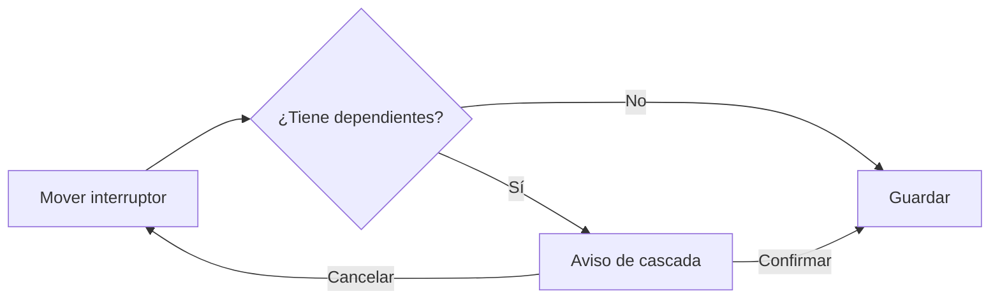

# CHG-139 · Funciones apagables dentro de cada módulo
**Estado:** Borrador
**Nivel:** M
**Modelo sugerido:** estandar
<!-- Estados y nivel se cambian SOLO con node .claude/team.mjs. Modelo: un perfil de docs/TEAM_MODELS.md -->
**Creado:** 2026-11-17 · **Aprobado:** — · **Cerrado:** —
**Relacionado:** CHG-093, CHG-095, CHG-134, CHG-137

## 0. En palabras simples
- Qué vas a ver distinto: en Ajustes → Personalizar módulos, debajo de Salud, Comidas y Tareas aparece una lista de funciones con interruptor (por ejemplo, Ciclo menstrual, Medicamentos, Compras, Gantt). Lo que apagas desaparece de las pestañas y de Mi día, y deja de enviarte recordatorios. Tus datos se conservan.
- Cómo comprobarlo tú: apaga «Ciclo» en Salud y mira que su pestaña ya no aparece. Apaga «Ingredientes»… no se puede: es la base de Comidas. Apaga «Recetas» y verás un aviso de que también se apagan las funciones que dependen de ella; al confirmar, se apagan juntas.

## 1. Resumen
Hoy solo se activan o desactivan módulos completos. Se añade una segunda capa de **funciones** por módulo, todas activas por defecto, apagables por persona. Apagar una función oculta sus pestañas y accesos y detiene sus recordatorios; no borra datos, no cierra rutas directas ni toca las herramientas MCP (igual que hoy con los módulos, `docs/first-experience.md:23`). Si otras funciones dependen de la que se apaga, se avisa y se apagan en cascada; al encender una, se encienden las que necesita.

## 2. Producto (product-manager)
- Problema / usuario: no todas las personas usan todas las vistas (p. ej. quien no tiene ciclo menstrual, o no registra compras). Ver pestañas inútiles añade ruido (`docs/PRODUCT.md`: la amplitud debe acompañar sin abrumar).
- Incluye:
  - Salud: mediciones, medicamentos, sueño, ciclo, tendencias, vista del cuerpo (Registro es base y no se apaga).
  - Comidas: recetas, preparaciones, qué cocinar, compras, historial de compras, movimientos de inventario (Planificación e Ingredientes son base: recetas, plan, preparaciones e inventario dependen de ellos por claves foráneas).
  - Tareas: gantt, calendario, flujo, kanban, planificación, progreso (Lista es base).
  - Dependencias declaradas y cascada con confirmación.
  - Detener recordatorios de medicamentos si Medicamentos está apagado.
- No incluye: funciones en otros módulos; cerrar rutas directas; ocultar herramientas MCP; borrar datos; cambios de esquema.
- Criterios de aceptación:
  - Dado un usuario existente, cuando entra tras el despliegue, entonces todas las funciones siguen activas.
  - Dado Ciclo apagado, cuando abre Salud, entonces no ve la pestaña Ciclo; otro usuario sigue viéndola.
  - Dada una función con dependientes, cuando la apaga, entonces ve un aviso que los lista y, solo al confirmar, se apagan todos.
  - Dada una función apagada que requiere otra apagada, cuando la enciende, entonces se enciende también la requerida.
  - Dado Medicamentos apagado, cuando corre el generador de notificaciones, entonces no crea recordatorios de medicamentos.
  - Dado un enlace directo a una función apagada, cuando se abre, entonces responde 200 como hoy.

## 3. UX/UI
### 3.1 Experiencia (ux-designer)
- Flujo y cantidad de pasos: Ajustes → Personalizar módulos → mover un interruptor → (si hay dependientes) confirmar → Guardar. 3-4 pasos.
- Qué contiene cada pantalla y qué es lo más importante: la lista existente de módulos; cada módulo activo con funciones se expande mostrando sus interruptores con una línea de descripción. Lo central: saber qué se queda y qué se va.
- Estados: módulo apagado → su grupo de funciones oculto (se conserva lo guardado); funciones base → interruptor fijo en «Siempre activa»; error de validación → mensaje en línea; guardado → recarga de la sección como hoy.
- Información necesaria y momento de presentación: el aviso de cascada aparece al mover el interruptor, antes de guardar.
- Accesibilidad de uso: interruptores con etiqueta asociada, diálogo con foco atrapado, Escape cancela, Enter confirma.

```
Salud                                   [x]
  ├ Mediciones        Peso, tensión…    (o)
  ├ Medicamentos      Tomas y avisos    (o)
  ├ Sueño             Horas y calidad   (o)
  ├ Ciclo             Dato sensible     ( )   ← apagado
  └ Tendencias        Requiere medicion.(o)
         ┌──────────────────────────────┐
         │ Apagar «Mediciones»           │
         │ También se apagará Tendencias.│
         │ Tus datos se conservan.       │
         │      [Cancelar] [Apagar]      │
         └──────────────────────────────┘
```



### 3.2 Visual (ui-designer)
- Distribución: grupo anidado bajo cada módulo, sangría de un nivel, una fila por función.
- Componentes existentes a reutilizar: `x-ui.switch` (patrón de `GameSettings`), `resources/views/livewire/onboarding/module-choices.blade.php` (rama no guiada), diálogo/confirmación existente del sistema UI.
- Jerarquía, color, tipografía y espaciado: tokens existentes; función = texto base, descripción = texto secundario.
- Responsive y contraste: una columna en móvil; verificar con los criterios de `docs/TESTING.md` (pocas y muchas funciones, textos largos).

### 3.3 Escritura (ux-writer)
- Ubicación y estado: sección «Personalizar módulos», diálogo de cascada.
- Textos finales: «Al apagar {función} también se apagará {lista}. Tus datos se conservan.» · «Apagar» / «Cancelar» · «Siempre activa» · «Al encender {función} también se encenderá {lista}, porque la necesita.» · Ciclo: «Dato sensible. No envía recordatorios.»
- Reglas de docs/UX-WRITING.md aplicadas: tuteo, verbos claros, sin jerga técnica.
- Criterios de aceptación de los textos: la persona entiende qué se apaga y que no pierde datos, sin leer nada más.

## 4. Diseño técnico (software-architect)
- Archivos a crear / modificar: `app/Services/Experience/PersonalExperience.php` (catálogo de funciones, `featureVisible`, `saveFeatures` con cascada), `config/modules.php` (bloque `features` y `'feature'` por pestaña), `app/Livewire/Settings/ModulePreferences.php` y su vista, `resources/views/components/module-tabs.blade.php`, `module-shell.blade.php`, `livewire/home/dashboard.blade.php`, `app/Services/Notifications/GenerateNotifications.php` / `GenerateMedicationReminders.php`, `app/Support/HealthTrends.php` si cuenta bloques apagados.
- Enfoque y patrones: persistir en el JSON `personal-experience` una lista de funciones **apagadas** (`features_off`); ausente = todo activo; sin migración. Escribir con `change()` (conserva otras claves). Memo por petición vía `state()`. Cascada calculada desde `requires` en config.
- Riesgos y mitigación: dejar un módulo sin pestañas → las funciones base no se apagan; dependencias mal declaradas → test que recorre el catálogo; coste de consultas en Mi día → reutilizar el memo (revisar `DashboardQueryBudgetTest`).
- Qué NO tocar: rutas, servidor MCP, esquema, `social`/`home`/`settings`, borrado de datos.

## 5. Pruebas (qa-tester)
| Caso | Tipo | Nivel | Test |
|---|---|---|---|
| Por defecto todo activo para usuarios existentes | Feature | 1 | `PersonalExperienceTest` |
| Aislamiento entre usuarios | Feature | 1 | `PersonalExperienceTest` |
| Clave de función inventada rechazada | Feature | 1 | `PersonalExperienceTest` |
| Cascada al apagar y al encender | Feature | 1 | `PersonalExperienceTest` |
| Funciones base no se apagan | Feature | 1 | `PersonalExperienceTest` |
| Pestañas filtradas en Salud/Comidas/Tareas | Feature | 2 | `ModuleExperienceTest` |
| Ruta directa de función apagada responde 200 | Feature | 2 | `PersonalExperienceTest` |
| Sin recordatorios de medicamentos si está apagado | Feature | 2 | test de notificaciones |
| Diálogo de cascada, móvil y escritorio | Browser | 3 | `personal-experience.interaction.spec.js` |
- Comando para verificar: `php artisan test --filter=PersonalExperience`, suite completa con `timeout` también contra MySQL, `php artisan ui:conformance`, `npm run build`, `git diff --check`.
- Regresión a vigilar: `DashboardQueryBudgetTest`, `BackendQueryBudgetTest`, `ScreenArchetypeTest`, `HealthTrendsTest`, `LearningModuleTest`.

## 6. Documentación (tech-writer)
- Docs a actualizar: `docs/first-experience.md` (funciones por módulo y qué no cambia al apagar), `docs/ARCHITECTURE.md` si se documenta el catálogo de funciones.

## 7. Tareas
- [ ] T1 · Catálogo de funciones y reglas de dependencia en config — Resp: developer — Modelo: estandar — Archivos: `config/modules.php` — Hecho cuando: cada función declara etiqueta, descripción y `requires`.
- [ ] T2 · Guardar y consultar funciones apagadas con cascada — Resp: developer — Modelo: estandar — Archivos: `PersonalExperience.php` — Hecho cuando: pasan los tests de cascada, validación y aislamiento.
- [ ] T3 · Ocultar pestañas y accesos de funciones apagadas — Resp: developer — Modelo: estandar — Archivos: `module-tabs`, `module-shell`, `dashboard` — Hecho cuando: lo apagado no aparece y las rutas siguen abriendo.
- [ ] T4 · Detener recordatorios de medicamentos apagados — Resp: developer — Modelo: estandar — Archivos: `GenerateNotifications.php`, `GenerateMedicationReminders.php` — Hecho cuando: no se crean recordatorios.
- [ ] T5 · Interruptores y aviso de cascada en Personalizar módulos — Resp: developer — Modelo: estandar — Archivos: `ModulePreferences.php`, su vista — Hecho cuando: se cumple el boceto y los textos finales.
- [ ] T6 · Pruebas y documentación — Resp: developer — Modelo: estandar — Archivos: tests, `docs/first-experience.md` — Hecho cuando: la verificación de la sección 5 pasa.

## 8. Bitácora de implementación (developer)

## 9. Preguntas abiertas, decisiones e historial
- 2026-11-17 — Creado en to-do/ (Borrador, nivel M)
- 2026-11-17 — Decisión del usuario: apagar = ocultar y detener avisos (rutas y MCP siguen igual); dependencias = aviso de confirmación con cascada.
- Abierta: ¿las funciones base de Comidas son solo Ingredientes y Planificación, o también Compras? (Ingredientes sí es base).
