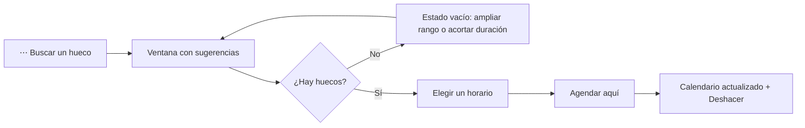

# CHG-142 · Buscar un hueco en la agenda para una tarea
**Estado:** Borrador
**Nivel:** L
**Modelo sugerido:** razonamiento
<!-- Estados y nivel se cambian SOLO con node .claude/team.mjs. Modelo: un perfil de docs/TEAM_MODELS.md -->
**Creado:** 2026-11-17 · **Aprobado:** — · **Cerrado:** —
**Relacionado:** CHG-016, CHG-017, CHG-051, CHG-052, CHG-070, CHG-072, CHG-133, CHG-135, CHG-139

## 0. En palabras simples
- Qué vas a ver distinto: en el menú ⋯ de una tarea aparece **«Buscar un hueco»**. Se abre una ventana que te muestra tu día o semana con lo que ya tienes ocupado y te propone horarios libres donde cabe esa tarea, según cuánto dura. Eliges uno y la tarea queda agendada ahí.
- Cómo comprobarlo tú: toma una tarea de 1 hora, abre ⋯ → «Buscar un hueco», mira los horarios sugeridos, toca uno, confirma, y comprueba que aparece en el calendario sin chocar con otra cosa. Cambia la duración a 2 h y mira cómo las sugerencias se ajustan.

## 1. Resumen
Planificar tareas cuando la agenda está llena obliga a mirar el calendario y adivinar. Se agrega una ventana de planificación al estilo «encontrar un hueco» de Teams: calcula huecos libres a partir de lo que ocupa la agenda (tareas con hora, comidas, tomas de medicamentos y otros bloques con hora), dentro de la jornada de la persona, y permite agendar la tarea con un toque. Hoy no existe nada de disponibilidad, horario hábil ni zona horaria por persona: se construye un servicio de huecos y un ajuste de jornada. La UI y la UX son lo más importante del cambio.

## 2. Producto (product-manager)
- Problema / usuario: planifico tareas y no sé dónde encajan porque mi agenda está llena; hoy tengo que revisar el calendario a mano.
- Incluye:
  - Acción «Buscar un hueco» en el menú ⋯ de la lista de tareas y del calendario, y un acceso en la sección «Programación» del editor de tarea.
  - Ventana con: resumen de la tarea, duración editable (chips 15 min, 30 min, 1 h, 2 h y otra), rango (esta semana, la próxima), preferencia de momento del día (cualquiera, mañana, tarde), línea de tiempo con lo ocupado y huecos sugeridos como chips.
  - Agendar en el hueco elegido (inicio y fin) con aviso y «Deshacer».
  - Servicio de huecos libres reutilizable que considera como ocupado: tareas con hora (`TaskCalendar::events()`), comidas (`MealSchedule`), tomas de medicamentos (`MedicationSchedule`) y fuera de la jornada.
  - Ajuste «Horario para planificar» (días y horas hábiles, margen entre bloques) en Tareas → Ajustes, con patrón de `MealSchedule` y `ModuleSetting('tasks')`.
- No incluye: lectura de calendarios externos (Google Calendar, CalDAV de eventos); sugerencias automáticas sin que la persona abra la ventana; reprogramar varias tareas a la vez; cambios a recurrencia (solo se agenda la ocurrencia actual, como `moveTask`); citas de salud y planes, que no tienen hora (ver pregunta abierta).
- Criterios de aceptación (Dado/Cuando/Entonces):
  - Dada una tarea con 60 min estimados, cuando abro «Buscar un hueco», entonces veo hasta N horarios libres de 60 min dentro de mi jornada, ordenados del más próximo al más lejano, sin cruzar nada ocupado.
  - Dado un horario elegido, cuando confirmo, entonces la tarea queda con inicio y fin en ese hueco, el calendario se refresca y puedo deshacer.
  - Dada una tarea sin duración, cuando abro la ventana, entonces propone 60 min y me deja cambiarla antes de elegir.
  - Dado que no hay huecos en el rango, cuando abro la ventana, entonces veo un estado vacío que ofrece ampliar el rango o acortar la duración.
  - Dada una tarea de todo el día o varios días, cuando abro la ventana, entonces la acción sigue disponible y trata la tarea con la duración elegida.
  - Dado otro usuario, cuando calcula huecos, entonces solo usa mis datos.
  - Dado que cambio mi horario de jornada, cuando busco de nuevo, entonces las sugerencias lo respetan.

## 3. UX/UI
### 3.1 Experiencia (ux-designer)
- Flujo y cantidad de pasos: ⋯ → «Buscar un hueco» → (opcional ajustar duración/rango) → tocar un horario → «Agendar aquí». Mínimo 3 toques; sin pasos obligatorios intermedios. Los valores por defecto (duración de la tarea, esta semana, cualquier momento) ya dan resultados.
- Qué contiene cada pantalla y qué es lo más importante: arriba, la tarea y su duración; en el centro, **los horarios sugeridos como chips agrupados por día**, y al lado/debajo, la línea de tiempo del día seleccionado con lo ocupado y el hueco resaltado. Lo más importante: ver rápido cuándo cabe y qué se desplaza.
- Estados (vacío / carga / error / éxito / validaciones): carga con `x-ui.skeleton`; vacío «sin huecos» con acciones (ampliar rango, acortar duración); error sereno y reintentar; éxito con snackbar «Tarea agendada el {día} a las {hora}» y «Deshacer»; si alguien ocupó el hueco mientras tanto, aviso y recálculo.
- Información necesaria y momento de presentación: la jornada y la zona horaria se muestran solo si afectan (una nota «Según tu horario de 8:00 a 18:00» con enlace a ajustes). No se pide nada nuevo para empezar.
- Accesibilidad de uso: chips como botones con nombre completo («Martes 18 de noviembre, 10:00 a 11:00»), navegación por teclado entre chips, foco devuelto al ⋯ al cerrar, línea de tiempo con alternativa textual (lista de bloques ocupados), no depender solo del color.

```
┌ 🗓 Buscar un hueco ───────────────────── ⤢ ✕ ┐
│ Preparar informe de ventas                    │
│ Duración (15m)(30m)(●1h)(2h)(Otra)            │
│ Rango   (●Esta semana)(Próxima)  Momento (Cualquiera ▾)│
├───────────────────────────────────────────────┤
│ Hoy, mar 18                                    │
│  (14:00–15:00) (15:30–16:30)                   │
│ Mañana, mié 19                                 │
│  (08:00–09:00) (10:30–11:30) (16:00–17:00)     │
│ Jue 20                                         │
│  (09:00–10:00)                                 │
├──────── Mié 19 ────────────────────────────────┤
│ 08 ▓▓ hueco   10 ░ Reunión ░  10:30 ▓▓ hueco   │
├───────────────────────────────────────────────┤
│ Cancelar                   [Agendar mié 19 · 08:00] │
└───────────────────────────────────────────────┘
 móvil: pantalla completa; filtros arriba en una franja, chips en lista, línea de tiempo plegable
```



### 3.2 Visual (ui-designer)
- Distribución: diálogo con cabecera (ícono, título, expandir, cerrar), filtros en una fila, lista de chips por día y línea de tiempo; en móvil, `x-ui.sheet` a pantalla completa o `form-dialog` expandido según la decisión de arquitectura.
- Componentes existentes a reutilizar: `x-ui.form-dialog` o `x-ui.dialog` estándar, `x-ui.chip` (variante `suggestion`), `x-ui.state` y `x-ui.skeleton`, `x-ui.snackbar` con acción, `x-ui.field`/`x-ui.select`, `partials/schedule-fields.blade.php` (chips de duración), `x-ui.menu-item` para el ⋯.
- Jerarquía, color, tipografía y espaciado (tokens): hueco seleccionado con color primario del módulo Tareas; ocupado en superficie neutra; sin estilos en línea. La posición/altura de bloques de la línea de tiempo requiere una custom property dinámica nueva declarada con motivo en `config/ui-conformance.php`.
- Responsive y contraste: 360/390/768/1440; objetivos de 44 px; contraste AA del estado seleccionado.

### 3.3 Escritura (ux-writer)
- Ubicación y estado: ⋯ de tarea (lista y calendario), enlace en «Programación», ventana, vacío, éxito y errores.
- Textos finales (variables y variantes): «Buscar un hueco» · «Horarios sugeridos» · «Duración» · «Esta semana / La próxima semana» · «Agendar aquí» / «Agendar {día} · {hora}» · «Tarea agendada el {día} a las {hora}.» · vacío: «No encontré huecos de {duración} en este rango. Prueba con otro rango o una duración menor.» · aviso: «Ese horario ya no está libre. Te muestro otros.» · «Según tu horario de {inicio} a {fin}. Cambiar».
- Reglas de docs/UX-WRITING.md aplicadas: tuteo, verbo concreto en botones, errores serenos sin culpa, sin humor en acciones esenciales; término «hueco» definido en la tabla de vocabulario.
- Criterios de aceptación de los textos: «hueco» se usa igual en todas las superficies; ningún mensaje culpa a la persona.

## 4. Diseño técnico (software-architect)
- Archivos a crear / modificar:
  - Crear `app/Services/Task/TaskSlotFinder.php` (entrada: usuario, duración, rango, jornada, preferencia; salida: lista de huecos). Obtiene ocupación de tareas con hora, `MealSchedule::events()`, `MedicationSchedule` y bloques de foco planificados; resta de la jornada; aplica margen y descarta el pasado.
  - Crear componente Livewire de la ventana y su vista (`app/Livewire/Task/FindSlot.php`, `resources/views/livewire/task/find-slot.blade.php`), con acción de agendar que reutiliza `InteractsWithTaskSchedule` / lógica de `TaskCalendar::moveTask` y una Action nueva `app/Actions/Task/ScheduleTaskInSlot.php` (con Deshacer, patrón de `ShiftTasksToDate`).
  - Modificar `resources/views/livewire/task/task-list.blade.php:109-128` (ítem de menú), `resources/views/livewire/task/task-calendar.blade.php:49-61` y `resources/js/task-calendar.js` + `TaskCalendar::calendarAction()` (acción nueva en el `match`), y `partials/schedule-fields.blade.php` (enlace).
  - Ajustes: sección de horario en `TaskSettings` (`SECTIONS`), ruta y vista, almacenamiento en `ModuleSetting('tasks')` con defaults en config.
  - Catálogo UI: entradas en `/ui-catalog` para lo nuevo (`ComponentCatalog.php`, `CatalogFixtures.php`).
- Enfoque y patrones a seguir: servicio puro y testeable, sin acoplarse a Livewire; la UI y una posible herramienta MCP comparten el servicio. Evento de apertura por el bus existente (`task-editor`/evento propio) y refresco con `task-calendar-refresh`, `task-records-changed`. Zona horaria: `config('app.timezone')` (America/Bogota) en servidor; verificar que FullCalendar no desfase si el navegador está en otra zona. Respetar los presupuestos de consultas (CHG-135): una consulta por fuente de ocupación para el rango completo, sin N+1.
- Riesgos y mitigación: ocupación incompleta (sin eventos externos ni citas con hora) → mostrar la nota de qué se considera; condiciones de carrera al agendar → revalidar el hueco al confirmar; tareas recurrentes → solo la ocurrencia actual; superficie nueva sobre diálogos de tarea → `wire:key` fijo, `x-teleport`, pila de superficies (CHG-101); colisión con CHG-139 (apagar Calendario/Planificación) → declarar la dependencia al aprobar ese CHG.
- Qué NO tocar: esquema de BD (el horario va en `ModuleSetting`), integración CalDAV, recurrencia, MCP existente (salvo la herramienta opcional), Mi día.

## 5. Pruebas (qa-tester)
| Caso | Tipo | Nivel | Test |
|---|---|---|---|
| Huecos libres respetan jornada, margen y pasado | Unit/Feature | 1 | nuevo `TaskSlotFinderTest` |
| Ocupación de tareas, comidas y medicamentos | Feature | 1 | `TaskSlotFinderTest` |
| Sin huecos devuelve vacío | Feature | 1 | `TaskSlotFinderTest` |
| Aislamiento entre usuarios | Feature | 1 | `TaskSlotFinderTest` |
| Agendar escribe inicio/fin y permite deshacer | Feature | 2 | `TaskFindSlotTest` |
| Hueco ocupado entre tanto se rechaza y recalcula | Feature | 2 | `TaskFindSlotTest` |
| Ítem ⋯ presente en lista y calendario | Feature | 2 | `TaskCalendarActionsTest`, `TaskListQuickActionsTest` |
| Ajuste de jornada (validación `H:i`, aislamiento) | Feature | 2 | patrón de `MealScheduleTest` |
| Presupuesto de consultas | Feature | 2 | `BackendQueryBudgetTest` |
| Ventana en 360/390/1440, teclado, axe | Browser | 3 | nuevo `task-find-slot.interaction.spec.js` |
- Comando para verificar: `php artisan test --filter=Task`, `php artisan ui:conformance`, `npm run build`, Playwright del spec nuevo, suite contra MySQL con `timeout`, `git diff --check`.
- Regresión a vigilar: `TaskViewsTest`, `TaskCalendarUnscheduledTest`, `TaskCalendarRecurrenceSuggestionTest`, `task-calendar.interaction.spec.js`, `ScreenArchetypeTest`.

## 6. Documentación (tech-writer)
- Docs a actualizar: `docs/UX-WRITING.md` (término «hueco»), `docs/design-system.md` (si se publica componente nuevo), `docs/integrations/task-focus.md` si se enlaza con foco, y una nota de uso en la documentación de Tareas.

## 7. Tareas
- [ ] T1 · Horario para planificar (jornada) en Tareas → Ajustes — Resp: developer — Modelo: estandar — Archivos: `TaskSettings`, vista, config — Hecho cuando: se guarda, valida y aísla por usuario.
- [ ] T2 · Servicio de huecos libres — Resp: developer — Modelo: razonamiento — Archivos: `TaskSlotFinder.php` — Hecho cuando: pasan los casos de jornada, ocupación, margen y vacío, con presupuesto de consultas.
- [ ] T3 · Ventana «Buscar un hueco» con sugerencias y línea de tiempo — Resp: developer — Modelo: razonamiento — Archivos: `FindSlot.php`, vista — Hecho cuando: cumple el boceto, los estados y la accesibilidad.
- [ ] T4 · Agendar en el hueco con Deshacer — Resp: developer — Modelo: estandar — Archivos: `ScheduleTaskInSlot.php` — Hecho cuando: escribe fechas, revalida y refresca el calendario.
- [ ] T5 · Acceso desde ⋯ (lista y calendario) y desde Programación — Resp: developer — Modelo: estandar — Archivos: `task-list.blade.php`, `task-calendar.blade.php`, `task-calendar.js`, `schedule-fields.blade.php` — Hecho cuando: la acción abre la ventana en todas las superficies.
- [ ] T6 · Catálogo UI, pruebas de navegador y documentación — Resp: developer — Modelo: estandar — Archivos: catálogo, spec nuevo, docs — Hecho cuando: pasa la verificación de la sección 5.

## 8. Bitácora de implementación (developer)

## 9. Preguntas abiertas, decisiones e historial
- 2026-11-17 — Creado en to-do/ (Borrador, nivel L) a partir de la exploración de agenda y menú de tareas.
- Abierta: jornada por defecto. Propuesta: lunes a viernes de 8:00 a 18:00 y margen de 10 min; editable en ajustes.
- Abierta: citas de salud y planes no tienen hora. Propuesta: no bloquean el día; solo bloquean lo que tiene hora.
- Abierta: ¿incluimos una herramienta MCP de solo lectura («buscar huecos») que comparta el servicio? Propuesta: sí, pero como CHG aparte para no crecer este.
- Abierta: ¿la ventana se abre como diálogo en escritorio y hoja a pantalla completa en móvil? Propuesta: sí.
- Abierta: ¿las tareas de otros (compartidas) bloquean? No aplica hoy (la app no comparte agendas).
