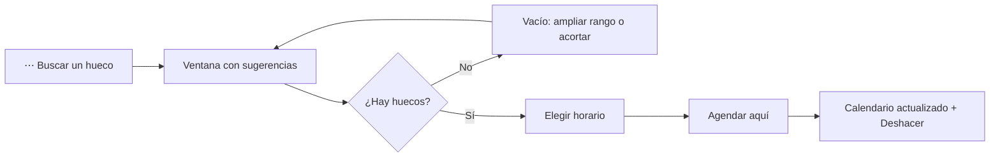

# CHG-143 · Ventana Buscar un hueco y agendar desde las tareas
**Estado:** Aprobado
**Nivel:** M
**Modelo sugerido:** razonamiento
<!-- Estados y nivel se cambian SOLO con node .claude/team.mjs. Modelo: un perfil de docs/TEAM_MODELS.md -->
**Creado:** 2026-11-17 · **Aprobado:** 2026-11-17 · **Cerrado:** —
**Relacionado:** CHG-016, CHG-017, CHG-051, CHG-052, CHG-070, CHG-072, CHG-101
**Depende de:** CHG-142 (servicio de huecos y horario para planificar). Se divide del CHG-142 original; CHG-144 (horario fijo) se integra al final.

## 0. En palabras simples
- Qué vas a ver distinto: en el menú ⋯ de una tarea aparece **«Buscar un hueco»**. Se abre una ventana que te muestra tu día o semana con lo ocupado y te propone horarios libres donde cabe la tarea, según cuánto dura. Eliges uno y la tarea queda agendada ahí.
- Cómo comprobarlo tú: toma una tarea de 1 hora, abre ⋯ → «Buscar un hueco», toca un horario sugerido, confirma y mira que aparece en el calendario sin chocar. Cambia la duración a 2 h y comprueba que las sugerencias se ajustan.

## 1. Resumen
Es la parte visible de «encontrar un hueco» al estilo de Teams. La ventana consume el servicio de huecos del CHG-142 y agenda con la lógica existente de calendario (`TaskCalendar::moveTask` / `InteractsWithTaskSchedule`) más una acción con Deshacer. La UI y la UX son lo más importante.

## 2. Producto (product-manager)
- Problema / usuario: planifico tareas y no sé dónde encajan porque mi agenda está llena.
- Incluye:
  - Acción «Buscar un hueco» en el ⋯ de la lista de tareas y del calendario (JS en `task-calendar.js` + `TaskCalendar::calendarAction()`), y un enlace en la sección «Programación» del editor.
  - Ventana con resumen de la tarea, duración editable (15 min, 30 min, 1 h, 2 h y otra), rango (esta semana, la próxima), momento del día (cualquiera, mañana, tarde), horarios sugeridos como chips por día y línea de tiempo del día elegido.
  - Agendar en el hueco con aviso y «Deshacer» (Action nueva con patrón de `ShiftTasksToDate`).
  - Revalidación del hueco al confirmar.
- No incluye: cálculo de huecos y ajustes de jornada (CHG-142); marcar tareas como horario fijo (CHG-144); herramienta MCP (CHG-145); calendarios externos; reprogramar varias tareas.
- Criterios de aceptación (Dado/Cuando/Entonces):
  - Dada una tarea de 60 min, cuando abro «Buscar un hueco», entonces veo horarios libres de 60 min dentro de mi jornada, del más próximo al más lejano.
  - Dado un horario elegido, cuando confirmo, entonces la tarea queda con inicio y fin ahí, el calendario se refresca y puedo deshacer.
  - Dada una tarea sin duración, cuando abro la ventana, entonces propone 60 min y puedo cambiarlos.
  - Dado que no hay huecos, cuando abro la ventana, entonces veo un estado vacío que ofrece ampliar el rango o acortar la duración.
  - Dado que otro bloque ocupó el hueco mientras decidía, cuando confirmo, entonces recibo un aviso y se recalculan las sugerencias.
  - Dada una tarea de todo el día o multidía, cuando uso la acción, entonces funciona con la duración elegida.

## 3. UX/UI
### 3.1 Experiencia (ux-designer)
- Plantilla: diálogo de consulta y acción sobre el módulo Tareas (pantalla completa en móvil); no existe `## Anatomía` para diálogos.
- Flujo y cantidad de pasos: ⋯ → «Buscar un hueco» → (opcional ajustar duración/rango) → tocar un horario → «Agendar aquí». Tres toques; los valores por defecto ya dan resultados.
- Qué contiene cada pantalla y qué es lo más importante: tarea y duración arriba; **horarios sugeridos como chips agrupados por día**; línea de tiempo del día seleccionado con lo ocupado y el hueco resaltado. Lo central: ver rápido cuándo cabe y qué hay alrededor.
- Estados (vacío / carga / error / éxito / validaciones): carga con skeleton; vacío con acciones (ampliar rango, acortar duración); error sereno con reintento; éxito con aviso y «Deshacer»; hueco ocupado → aviso y recálculo.
- Información necesaria y momento de presentación: nota «Según tu horario de {inicio} a {fin}» con enlace a ajustes, solo cuando afecta.
- Accesibilidad de uso: chips como botones con nombre completo («Martes 18 de noviembre, 10:00 a 11:00»), teclado entre chips, foco devuelto al ⋯ al cerrar, línea de tiempo con alternativa en lista de bloques ocupados, sin depender solo del color.

```
┌ 🗓 Buscar un hueco ───────────────────── ⤢ ✕ ┐
│ Preparar informe de ventas                    │
│ Duración (15m)(30m)(●1h)(2h)(Otra)            │
│ Rango (●Esta semana)(Próxima)  Momento [Cualquiera ▾]│
├───────────────────────────────────────────────┤
│ Hoy, mar 18                                    │
│  (14:00–15:00) (15:30–16:30)                   │
│ Mañana, mié 19                                 │
│  (08:00–09:00) (10:30–11:30) (16:00–17:00)     │
├──────── Mié 19 ────────────────────────────────┤
│ 08 ▓ hueco │ 09 ░ Reunión ░ │ 10:30 ▓ hueco    │
├───────────────────────────────────────────────┤
│ Cancelar                [Agendar mié 19 · 08:00]│
└───────────────────────────────────────────────┘
 móvil: pantalla completa; filtros en franja, chips en lista, línea de tiempo plegable
```



### 3.2 Visual (ui-designer)
- Distribución: diálogo (escritorio) y pantalla completa (móvil) con cabecera, filtros en una fila, chips por día y línea de tiempo.
- Componentes existentes a reutilizar: `x-ui.form-dialog` o `x-ui.dialog` estándar (decidir con `create-action-pattern`), `x-ui.sheet`, `x-ui.chip` (`suggestion`), `x-ui.state`, `x-ui.skeleton`, `x-ui.snackbar`, `x-ui.menu-item`, chips de duración de `partials/schedule-fields.blade.php`.
- Jerarquía, color, tipografía y espaciado (tokens): hueco seleccionado con el color del módulo Tareas; ocupado neutro; sin estilos en línea. Posición y altura de la línea de tiempo con una custom property dinámica nueva declarada con motivo en `config/ui-conformance.php`.
- Responsive y contraste: 360/390/768/1440; objetivos de 44 px; contraste AA.

### 3.3 Escritura (ux-writer)
- Ubicación y estado: ⋯, ventana, vacío, éxito y errores.
- Textos finales (variables y variantes): «Buscar un hueco» · «Horarios sugeridos» · «Duración» · «Esta semana / La próxima semana» · «Agendar aquí» / «Agendar {día} · {hora}» · «Tarea agendada el {día} a las {hora}.» · «No encontré huecos de {duración} en este rango. Prueba con otro rango o una duración menor.» · «Ese horario ya no está libre. Te muestro otros.» · «Según tu horario de {inicio} a {fin}. Cambiar».
- Reglas de docs/UX-WRITING.md aplicadas: tuteo, verbo concreto, errores serenos, sin humor en acciones esenciales; «hueco» entra a la tabla de vocabulario.
- Criterios de aceptación de los textos: «hueco» igual en todas las superficies; ningún mensaje culpa a la persona.

## 4. Diseño técnico (software-architect)
- Archivos a crear / modificar: crear `app/Livewire/Task/FindSlot.php`, `resources/views/livewire/task/find-slot.blade.php`, `app/Actions/Task/ScheduleTaskInSlot.php`; modificar `task-list.blade.php:109-128`, `task-calendar.blade.php:49-61`, `resources/js/task-calendar.js`, `TaskCalendar::calendarAction()`, `partials/schedule-fields.blade.php`; entradas en `/ui-catalog` (`ComponentCatalog.php`, `CatalogFixtures.php`).
- Enfoque y patrones a seguir: la ventana solo consume `TaskSlotFinder` (CHG-142); escritura con la lógica de `moveTask`/`InteractsWithTaskSchedule`; refresco con `task-calendar-refresh` y `task-records-changed`; `x-teleport` y `wire:key` fijo; pila de superficies (CHG-101); zona horaria `config('app.timezone')`.
- Riesgos y mitigación: carrera al agendar → revalidar en el servidor; recurrentes → solo la ocurrencia actual; ⋯ del calendario es JS → pruebas de navegador; colisión con CHG-139 si apaga Calendario → declararlo al aprobar.
- Qué NO tocar: esquema, CalDAV, recurrencia, Mi día, MCP.

## 5. Pruebas (qa-tester)
| Caso | Tipo | Nivel | Test |
|---|---|---|---|
| Agendar escribe inicio/fin y permite deshacer | Feature | 1 | nuevo `TaskFindSlotTest` |
| Hueco ocupado entre tanto se rechaza y recalcula | Feature | 1 | `TaskFindSlotTest` |
| Ítem ⋯ en lista y calendario | Feature | 2 | `TaskCalendarActionsTest`, `TaskListQuickActionsTest` |
| Aislamiento entre usuarios | Feature | 2 | `TaskFindSlotTest` |
| Estados vacío/carga/error | Feature | 2 | `TaskFindSlotTest` |
| Ventana en 360/390/1440, teclado, axe | Browser | 3 | nuevo `task-find-slot.interaction.spec.js` |
- Comando para verificar: `php artisan test --filter=Task`, `php artisan ui:conformance`, `npm run build`, Playwright del spec, suite contra MySQL con `timeout`, `git diff --check`.
- Regresión a vigilar: `TaskViewsTest`, `TaskCalendarUnscheduledTest`, `task-calendar.interaction.spec.js`, `ScreenArchetypeTest`.

## 6. Documentación (tech-writer)
- Docs a actualizar: `docs/UX-WRITING.md` (término «hueco»), `docs/design-system.md` si hay componente nuevo.

## 7. Tareas
- [ ] T1 · Ventana con sugerencias, filtros y línea de tiempo — Resp: developer — Modelo: razonamiento — Archivos: `FindSlot.php`, vista — Hecho cuando: cumple el boceto, estados y accesibilidad.
- [ ] T2 · Agendar en el hueco con Deshacer y revalidación — Resp: developer — Modelo: estandar — Archivos: `ScheduleTaskInSlot.php` — Hecho cuando: escribe fechas, revalida y refresca el calendario.
- [ ] T3 · Acceso desde ⋯ (lista y calendario) y desde Programación — Resp: developer — Modelo: estandar — Archivos: `task-list.blade.php`, `task-calendar.blade.php`, `task-calendar.js`, `schedule-fields.blade.php` — Hecho cuando: abre la ventana en todas las superficies.
- [ ] T4 · Catálogo UI, pruebas de navegador y documentación — Resp: developer — Modelo: estandar — Archivos: catálogo, spec, docs — Hecho cuando: pasa la verificación de la sección 5.

## 8. Bitácora de implementación (developer)

## 9. Preguntas abiertas, decisiones e historial
- 2026-11-17 — Creado dividiendo el CHG-142 original (Borrador, nivel M).
- 2026-11-17 — Decisión delegada por el usuario («identifica tú la mejor manera»): diálogo en escritorio y pantalla completa en móvil.
- 2026-11-17 — Aprobado por el usuario (Compuerta 2)
