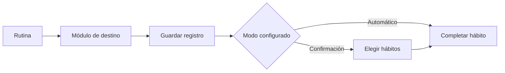

# CHG-183 · Acciones y cumplimiento de hábitos desde Diario e Hidratación
**Estado:** Borrador
**Nivel:** M
**Modelo sugerido:** estandar
<!-- Estados y nivel se cambian SOLO con node .claude/team.mjs. Modelo: un perfil de docs/TEAM_MODELS.md -->
**Creado:** 2026-11-19 · **Aprobado:** — · **Cerrado:** —
**Relacionado:** —

## 0. En palabras simples
Configura qué abrir al hacer un hábito y si Diario o Hidratación pueden marcarlo. Pruébalo desde una rutina y guarda un registro.

## 1. Resumen
Separar ejecución, reconocimiento y acción posterior. La primera integración cubre Diario e Hidratación web.

## 2. Producto
- Hábitos existentes y nuevos comienzan con ejecución sin acción y cumplimiento manual. El usuario puede marcar manualmente en cualquier modo.
- La detección completa en la fecha del registro o presenta una selección de hábitos. Cancelar conserva el registro y deja pendientes los hábitos.
- Administración global y detección desde MCP o notificaciones quedan fuera.

## 3. UX/UI
### 3.1 Experiencia
- Plantilla: seguimiento diario existente de Hábitos, Diario e Hidratación.
- El botón de cada fila sigue abriendo la rutina. El paso ofrece la acción configurada y permite regresar al mismo punto o avanzar si el hábito se completó.
- Reutilizar editores de destino, devolver foco al cerrar diálogos y mostrar errores en su campo.

```text
Editar hábito   Para hacerlo [Abrir Diario ▼]   Cómo se completa [Con confirmación ▼]
                Fuente [Entrada de diario finalizada ▼]   Al completarlo [...]
Rutina          [Abrir Diario] [Completar] [Omitir]
Diario          [Guardar] [Guardar y finalizar] [Volver a la rutina]
Confirmación    ¿Qué hábitos completaste? [✓ Escribir en el diario]
                [Ahora no] [Completar]
```



### 3.2 Visual
Usar diálogos, acciones, tokens y editor compartidos. Mantener un layout responsive.

### 3.3 Escritura
Usar las etiquetas del boceto y las opciones Sin acción, Manual, Automático y Con confirmación. Mostrar Registrar agua al abrir el formulario de Hidratación.

## 4. Diseño técnico
- Persistir acción de ejecución y regla de cumplimiento por hábito con valores compatibles. Validar destinos internos con lista cerrada de Diario e Hidratación, y enlaces externos con esquema HTTP(S). Los formularios de destino son los existentes.
- Detectar Guardar y finalizar con texto en Diario una vez por entrada, incluso si se guardó antes. Guardar, autoguardar, editar y eliminar siguen disponibles sin activar detección. En Hidratación detectar solo altas web del formulario o registro rápido con categoría water.
- Pasar la evidencia del registro guardado al servicio de hábitos. Una operación explícita de marcado comparte recompensas y acciones con el servicio existente y aplica unicidad por usuario, hábito y día. Revalidar evidencia, usuario, fecha y configuración al confirmar. Las opciones aparecen seleccionadas y se pueden desmarcar.
- Guardar evidencia de forma independiente de la acción posterior. Omitir el registro posterior de líquido cuando la evidencia ya es una toma de agua, también en el modo que pediría datos. Las otras acciones conservan su comportamiento, con diálogos en secuencia. Desmarcar conserva el registro de origen.

## 5. Pruebas
- PHP: compatibilidad, acceso por usuario, concurrencia y reintentos, fechas, registros parciales, confirmación parcial, agua frente a otras bebidas, recompensas y desmarcado. Ejecutar php artisan test con filtros de hábitos, Diario e Hidratación afectados.
- UI: php artisan ui:conformance y prueba de flujo de ida y vuelta con teclado y móvil. npm run build si cambian assets.

## 6. Documentación
Actualizar la referencia funcional de Hábitos con los dos disparadores y los ejemplos de uso.

## 7. Tareas
- [ ] T1 · Configurar y abrir acciones desde la rutina — Resp: developer — Archivos: app/Livewire/Habit, resources/views/livewire/habit, database/migrations — Hecho cuando: el hábito conserva sus valores anteriores y puede abrir su destino y regresar.
- [ ] T2 · Detectar entradas finalizadas y altas de agua — Resp: developer — Archivos: app/Livewire/Journal/JournalEntries.php, app/Livewire/Water/WaterDaily.php, app/Services/HabitGamificationService.php — Hecho cuando: los modos y el marcado manual funcionan sin duplicar acciones y las pruebas pasan.
- [ ] T3 · Verificar la integración — Resp: qa-tester — Hecho cuando: pasan los escenarios funcionales, de accesibilidad y regresión.
- [ ] T4 · Documentar las opciones — Resp: tech-writer — Hecho cuando: la referencia explica cada modo y cuándo cuenta un registro.

## 8. Bitácora de implementación

## 9. Preguntas abiertas, decisiones e historial
- 2026-11-19 — Alcance acordado en planificación. Relacionado con CHG-184. LECCIÓN: ninguna.
