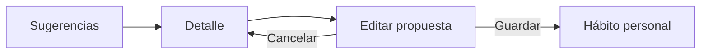

# CHG-184 · Catálogo de sugerencias de hábitos
**Estado:** Borrador
**Nivel:** M
**Modelo sugerido:** estandar
<!-- Estados y nivel se cambian SOLO con node .claude/team.mjs. Modelo: un perfil de docs/TEAM_MODELS.md -->
**Creado:** 2026-11-19 · **Aprobado:** — · **Cerrado:** —
**Relacionado:** —

## 0. En palabras simples
Explora ideas en Hábitos y personaliza la que quieras guardar como propia.

## 1. Resumen
Añadir Sugerencias a Hábitos y reutilizar el editor personal. Depende de las acciones de ejecución de CHG-183.

## 2. Producto
- Cinco ideas iniciales. Tomar agua al levantarse, leer unos minutos, escribir en el diario, preparar la ropa para el día siguiente y celebrar pequeños logros.
- Cada idea tiene descripción, propósito, guía de incorporación a la rutina y valores iniciales. Referencias verificadas cuando respalden una afirmación concreta.
- Solo guardar el formulario crea un hábito propio. Los cambios del catálogo no afectan copias. La bienvenida conserva su flujo.

## 3. UX/UI
### 3.1 Experiencia
- Plantilla: shell de Hábitos con lista y detalle.
- Seleccionar una idea muestra su contenido y habilita el FAB Agregar a mis hábitos. El FAB abre el formulario sobre esa pantalla. Cancelar devuelve el foco al disparador.

```text
Hábitos / Sugerencias
[Leer unos minutos]  [Escribir en el diario]  [Preparar la ropa]
Leer unos minutos
Propósito y cómo incorporarlo
[+ Agregar a mis hábitos] -> [Editor precargado: Cancelar | Guardar]
```



### 3.2 Visual
Usar el shell, tarjetas, FAB y diálogo canónicos. Mantener un layout responsive gobernado por CSS.

### 3.3 Escritura
Usar Sugerencias, Agregar a mis hábitos, Cancelar y Guardar. Explicar cada idea con una acción concreta y sin prometer resultados.

## 4. Diseño técnico
Catálogo versionado en el repositorio con claves estables. Validar en el servidor la clave seleccionada. Agregar la ruta habits.suggestions al módulo existente. Precargar el diálogo compartido con valores editables y modo manual. Sugerir la acción interna pertinente para Diario e Hidratación. Guardar por el flujo de creación personal existente.

## 5. Pruebas
- PHP: catálogo accesible a usuarios autenticados, selección y cancelación sin escrituras, guardado de valores editados y aislamiento por usuario.
- UI: verificar foco, teclado, vista móvil, navegación, FAB y formulario. Ejecutar php artisan ui:conformance y npm run build si cambian assets.

## 6. Documentación
Documentar el acceso al catálogo y cómo se convierte una sugerencia en hábito personal.

## 7. Tareas
- [ ] T1 · Explorar y agregar sugerencias — Resp: developer — Archivos: routes/web.php, config/modules.php, app/Livewire/Habit, resources/views/livewire/habit — Hecho cuando: se ven cinco ideas y solo guardar crea una copia editable.
- [ ] T2 · Verificar catálogo y creación — Resp: qa-tester — Hecho cuando: pasan pruebas y comprobaciones responsive y de teclado.
- [ ] T3 · Documentar el catálogo — Resp: tech-writer — Hecho cuando: queda descrito el flujo en la referencia de Hábitos.

## 8. Bitácora de implementación

## 9. Preguntas abiertas, decisiones e historial
- 2026-11-19 — Alcance acordado en planificación. Depende de CHG-183. LECCIÓN: ninguna.
